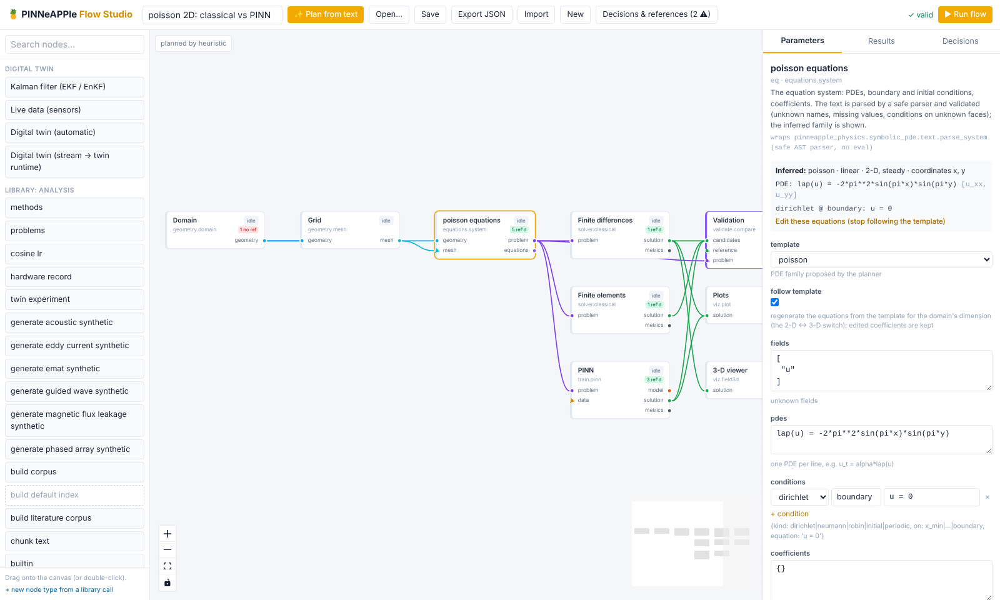

# PINNeAPPle Flow Studio

A node-based canvas for engineering flows, in the style of n8n: describe a problem, get one or more proposed flows,
edit the equations and the methods, run, and click any node to see what it produced (metrics, logs, figures, a
three.js 3-D view, the network architecture, tables). Everything a node does is a call into the PINNeAPPle library
(`pinneapple_flow` plus the existing packages); this folder is only the HTTP shell and the React frontend. The same
flows run without the GUI: `python -m pinneapple_flow run flow.json` or `pinneapple_flow.run(flow)`.



## Start (local first)

```bash
git clone https://github.com/PINNeAPPle-Labs/PINNeAPPle && cd PINNeAPPle
pip install -e ".[flow]"
python -m pinneapple_flow studio              # http://127.0.0.1:8765 (the built UI ships in frontend/dist)
```

Headless:

```bash
python -m pinneapple_flow examples                        # the bundled example flows
python -m pinneapple_flow run heat_1d                     # a bundled flow by name, or a path to a .json
python -m pinneapple_flow plan "transient heat in a 2D plate with fixed edges" -o plate.json
python -m pinneapple_flow run plate.json --from pinn      # re-run a node and what follows (the rest is cached)
```

```python
import pinneapple_flow as pf
res = pf.plan("identify the diffusivity of a rod from temperature measurements")
result = pf.run(res["proposals"][0]["flow"], workdir="work")
result.report("discover")["metrics"]
```

With Docker (app, optional Ollama, optional Postgres):

```bash
cp apps/flow_studio/.env.example apps/flow_studio/.env    # edit if needed
docker compose -f apps/flow_studio/docker-compose.yml up --build
docker compose -f apps/flow_studio/docker-compose.yml --profile llm --profile postgres up --build
```

## What is in the GUI

* **Planner** ("Plan from text"): the offline heuristic planner reads the description (keywords in English and
  Portuguese, quantities with units, `alpha = 0.1`-style values) and detects the PDE family, the dimension, steady or
  transient, the boundary type and what is asked (compare methods, identify a coefficient, a surrogate, HPO,
  uncertainty, a digital twin, a forecast, a take-off). An LLM planner (local Ollama, any OpenAI-compatible server
  through `base_url` including a model you host, or OpenAI / Anthropic with a key) gets the node catalog in its prompt;
  every proposal it returns is validated against the catalog and repaired, and the heuristic plan is shown when that
  fails. Each proposal says which planner produced it.
* **Canvas**: drag nodes from the palette, connect outputs to inputs (only compatible port types connect; colours show
  the types), edit parameters in the side panel (forms generated from each node's parameter schema), run the whole
  flow or "Run from here", watch each node's status (queued, running, done, failed, cached), and open a node's
  results. Save (with versions), open saved flows and examples, export and import JSON.
* **Equations**: the equations node shows the PDEs the system inferred; add, remove and edit PDEs, boundary and
  initial conditions and coefficients as text (`u_t = alpha*lap(u)`, `u_x = 0` on `x_max`). The text is parsed by a
  safe parser while you type and the panel shows the family, the derivatives and what is missing. `lap()` makes the
  same text valid in 1-D, 2-D and 3-D, so switching the domain node between 2-D and 3-D keeps the problem.
* **Architecture**: surrogate and HPO nodes suggest an architecture and show it as a layer graph with parameter
  counts; add or edit blocks (dense, residual, dropout, layer norm, activations) and the preview updates.

## Nodes

| Category | Node types (each wraps the library call shown in the GUI) |
|---|---|
| Problem | `geometry.domain` (1-D / 2-D / 3-D switch, box, time interval), `geometry.mesh`, `equations.system` |
| Solvers | `solver.classical` (finite differences / method of lines for any parsed system on a box, P1 finite elements for steady Poisson / Laplace), `solver.openfoam` (needs OpenFOAM on PATH) |
| Learning | `train.pinn` (physics, or physics + data), `surrogate.train` (DeepONet, FNO, MLP, POD + MLP), `surrogate.hpo`, `train.finetune` |
| Inverse | `inverse.discover` (inverse PINN), `inverse.calibrate` (least squares with the FD solver, identifiability) |
| Data | `data.observe` (sensors from a solution), `data.ingest` (CSV), `data.parametric` (solver sweeps), `data.grf_burgers` (operator benchmark) |
| Validation | `validate.compare` (relative L2 / max / RMSE against an exact solution or a reference, `pp.trust_card`), `validate.lab` (PINNeAPPle Lab tier A-D, seal on A/B) |
| Analysis | `uq.sensitivity` (Sobol indices) |
| Digital twin | `twin.connect` (simulated plant, recorded stream or MQTT into the twin runtime's ensemble Kalman filter) |
| Time series | `forecast.lab` (predictability first, then the forecaster zoo on purged walk-forward folds) |
| Systems | `flight.takeoff` (needs `pinneapple_simulation.flight`; reports itself unavailable until that library is on main) |
| Visualization / export | `viz.plot`, `viz.field3d` (three.js viewer), `viz.render` (Blender Cycles when `bpy` is installed, else a matplotlib shaded surface, and says which), `export.report` |

The document format, port types and how another app adds node types: [docs/guides/flow_schema.md](../../docs/guides/flow_schema.md).

## Example flows and what they measured

`pinneapple_flow/flows/` holds the examples; `examples/flow_studio/run_examples.py` runs them and writes
[examples/flow_studio/results/RESULTS.md](../../examples/flow_studio/results/RESULTS.md) with the numbers each flow
measured (and thumbnails). Seven reproduce earlier PINNeAPPle results (heat and Burgers PINN vs finite differences vs
exact, Poisson with FEM / FD / PINN and the trust card, DeepONet and FNO on Burgers, identifying a diffusivity, the
El Nino forecast, the take-off); three were typed as descriptions and planned by the heuristic planner (a plate
edited from 2-D to 3-D, a digital twin, a hybrid ROM + NN surrogate with HPO).

## Configuration

Environment variables or a `.env` file (see [.env.example](.env.example)):

| Variable | Meaning |
|---|---|
| `PINNEAPPLE_FLOW_HOME` | SQLite store, run folders and Lab (default `~/.pinneapple_flow`) |
| `PINNEAPPLE_FLOW_DB_URL` | any SQLAlchemy URL, e.g. `postgresql+psycopg://user:pw@host/db` |
| `PINNEAPPLE_FLOW_DATA` | the only folder the CSV ingest node reads files from |
| `PINNEAPPLE_FLOW_LLM_PROVIDER` | `none` (default), `ollama`, `openai_compatible`, `openai`, `anthropic` |
| `PINNEAPPLE_FLOW_LLM_MODEL`, `..._BASE_URL`, `..._API_KEY` | model, endpoint (Ollama or OpenAI-compatible), key |
| `PINNEAPPLE_FLOW_HOST`, `PINNEAPPLE_FLOW_PORT` | bind address (default `127.0.0.1:8765`) |
| `FLOW_USER`, `FLOW_PASSWORD_HASH`, `FLOW_RATE_LIMIT`, ... | login and limits (the shared appkit, prefix `FLOW`) |

## Security

* Binds to localhost by default. Any other address needs `FLOW_USER` + `FLOW_PASSWORD_HASH` (hash with
  `python -m pinneapple_security hash-password`); the server refuses to start otherwise unless `--insecure-no-auth` is
  given (the compose file uses it with the port published on the host's loopback only).
* The appkit security of the other PINNeAPPle apps applies: CSP and security headers, body limit, rate limits, login
  lockout, same-origin check on writes, audit log.
* A flow document cannot execute code: only registered node types run, parameters are checked against their schema,
  equations go through the safe parser (no `eval`), file reads are confined to `PINNEAPPLE_FLOW_DATA`, and the
  artifact endpoint serves files from the run folders only.

## Develop the frontend

```bash
cd apps/flow_studio/frontend
npm install
npm run dev            # http://127.0.0.1:5174, proxying /api to a running `python -m pinneapple_flow studio`
npm run build          # writes dist/ (committed, so users need no Node)
```

Tests: `pytest tests/test_flow_*.py` (the Playwright smoke test uses an installed Chromium and is skipped without
one; `FLOW_SCREENSHOTS=docs/flow_studio pytest tests/test_flow_studio_gui.py` refreshes the screenshots).

## Limits

* Finite differences run on boxes (interval, rectangle, box); disks and spheres are not meshed by the classical
  node yet. Finite elements here cover steady Poisson / Laplace with Dirichlet conditions.
* OpenFOAM runs only through `solver.openfoam` with an existing case, when OpenFOAM is installed.
* The LLM planner is tested with recorded answers (valid, invalid, repaired); its quality depends on the model you
  connect.

---

## Em português

O Flow Studio é uma tela de fluxos de engenharia baseada em nós (como o n8n): descreva o problema em texto, receba uma
ou mais propostas de fluxo, edite equações e métodos, execute e clique em qualquer nó para ver o que ele produziu
(métricas, logs, figuras, visualização 3-D, arquitetura da rede, tabelas). Toda a lógica está na biblioteca
(`pinneapple_flow` e os pacotes existentes); esta pasta é só a casca HTTP e o frontend.

```bash
pip install -e ".[flow]"
python -m pinneapple_flow studio                   # http://127.0.0.1:8765
python -m pinneapple_flow run heat_1d              # sem interface gráfica
```

* **Planejador**: heurístico (offline, entende português e inglês) ou LLM (Ollama local, servidor compatível com a API
  da OpenAI via `base_url`, inclusive um modelo hospedado por você, ou OpenAI / Anthropic com chave). A saída do LLM é
  validada contra o catálogo de nós e corrigida; se falhar, o plano heurístico é mostrado. Cada proposta informa qual
  planejador a gerou.
* **Equações**: o nó de equações mostra as EDPs inferidas; edite EDPs, condições de contorno e iniciais e
  coeficientes como texto, validado por um parser seguro (sem `eval`). `lap()` vale em 1-D, 2-D e 3-D.
* **Persistência**: SQLite por padrão; Postgres com `PINNEAPPLE_FLOW_DB_URL`. Docker: `docker compose -f
  apps/flow_studio/docker-compose.yml up --build` (perfis `llm` e `postgres` opcionais).
* **Segurança**: escuta em localhost por padrão; fora disso exige `FLOW_USER` e `FLOW_PASSWORD_HASH`.
