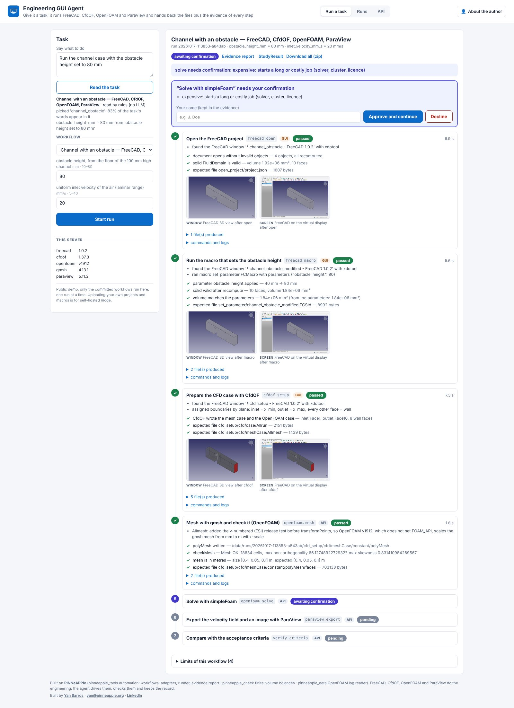

# Engineering GUI Agent

**guiagent.pinneapple.org** · port 8115 · day 27 extra · library: `pinneapple_tools.automation`
([guide](../../docs/guides/engineering_gui_agent.md))



**Pain.** A routine engineering study means clicking through CAD, a CFD pre-processor, a solver and a
post-processor: change a parameter, regenerate, mesh, solve, export, check. It is slow, easy to get subtly wrong (a
boundary condition that is not what you set, a mesh in the wrong units), and afterwards nobody can say exactly what
was done.

**What it does.** You give it a task: a sentence ("obstacle height 55 mm at 20 mm/s") or a structured workflow. It
runs the task in the engineering software inside its container and hands back the files plus the evidence of every
step. Think of it as Selenium for computational engineering. The application's API is always used first (FreeCAD
Python, CfdOF Python, the OpenFOAM command line, `pvpython`). GUI steps run in FreeCAD's real GUI on a virtual
display, are observed with xdotool and are screenshotted. Every step is checked against the files it produced. The run
stops on the first failure, and it stops before the solver until a person approves.

## Input

- A task sentence: rule-based by default, or read by a local LLM (Ollama) if one is configured. It picks a
  **committed** workflow and sets its inputs; units are converted and bounds checked.
- Or a workflow and its inputs: `{"workflow": "channel_obstacle", "inputs": {"obstacle_height_mm": 55}}`.
- Self-hosted mode also accepts your own workflows: a zip with `workflow.yaml`, your FreeCAD project and macros.

## Output

For each step, the record shows:

- its state and duration;
- the commands, with their logs;
- the actions taken, including compatibility edits;
- the produced files, with SHA-256;
- images, each labelled with what it is (virtual-display screenshot, 3D-view crop, application export, chart from a log);
- the checks.

The run as a whole delivers:

- the acceptance criteria, each with the measured value and the threshold;
- an HTML evidence report (print it to PDF from the browser);
- `study_result.json`, a StudyResult (schema `pinneapple.study_result/0`) for the Evidence Report app (day 30);
- a zip of everything: the modified FreeCAD document, the CfdOF/OpenFOAM case, the velocity field as CSV, images,
  logs.

## The committed workflow: channel with an obstacle

| # | Step | Mode |
|---|---|---|
| 1 | Open the parametric FreeCAD project (spreadsheet aliases) | GUI (FreeCAD on Xvfb) |
| 2 | Run the macro that sets the obstacle height; check the new volume against the parameters | GUI |
| 3 | Build the CfdOF case: laminar steady air, velocity inlet, pressure outlet, gmsh mesh | GUI (CfdOF needs FreeCADGui) |
| 4 | Mesh (gmsh, gmshToFoam), then checkMesh; check the mesh is in metres | API |
| 5 | Solve with simpleFoam. **Asks for confirmation** (expensive) | API |
| 6 | Export U and p of every cell to CSV and \|U\| on the mid-plane to PNG with ParaView | API |
| 7 | Criteria: converged; outflow = inflow within 1 %; inflow = prescribed velocity × area within 1 %; pressure drop below 0.01 Pa (an illustrative budget); velocity exported | API |

Measured on this image at 20 mm/s:

| Obstacle | Iterations | Pressure drop | Decision |
|---|---|---|---|
| 25 mm | 119 | 1.9 mPa | accepted |
| 55 mm | 162 | 3.5 mPa | accepted |
| 80 mm | 223 | 14.1 mPa | rejected |

A run takes about 30 s. While building the example, the agent's checks caught a mesh left in millimetres, a
diverging initialisation and an inlet that delivered 6 % less flow than prescribed. All three now come from real runs,
are handled, and are recorded in the evidence (see the guide).

## Integrations

- **Tools companies already use:** FreeCAD, CfdOF, OpenFOAM, ParaView. A Playwright adapter covers web UIs. A
  pywinauto adapter interface is documented for Windows tools (Ansys Workbench, Abaqus/CAE); it does not run in this
  Linux container.
- **PINNeAPPle:** the criteria use `pinneapple_check`'s finite-volume reader, and the logs are read by
  `pinneapple_data.simulation_metadata`. Results go out as a StudyResult for the Evidence Report app, and the run
  folder is plain files.
- **Simulation Workflow Runner (day 27):** its executors can call the same adapters
  (`get_adapter(name).run(action, params, ctx)`) once it is on main.

**Monetization: jobs, compute time, storage.** Paid tiers would add:

- more concurrent jobs, and longer or bigger cases (meshes, iterations);
- run storage and retention;
- self-hosted deployments, with your own workflows, macros and applications (SALOME, Windows tools).

## Limits

- One application chain and one committed workflow. SALOME (scriptable geometry and meshing) is the next adapter, and
  ParaView-only post-processing workflows are the cheapest to add; neither is implemented yet.
- Laminar, steady, one mesh (about 19 000 tetrahedra), and no mesh-independence study. gmsh runs several threads, so
  the cell count varies by a few hundred between runs.
- OpenFOAM v1912 (Ubuntu package) with CfdOF 1.37.3, which targets newer OpenFOAM. The agent makes two recorded edits
  for v1912 and does not use potential-flow initialisation.
- GUI steps are driven through FreeCAD's Python inside the GUI. xdotool finds and observes the windows; pixel clicking
  is available in the library but not needed here. There is no live remote desktop (noVNC): you see screenshots per
  step.
- The public demo runs one job at a time and only committed workflows. Uploads and macros are for self-hosted mode
  only.
- `study_result.json` uses a provisional schema until `pinneapple_data.contracts.StudyResult` is released.

## Run

```bash
docker build -f apps/guiagent/Dockerfile -t guiagent .          # from the repository root; about IMAGE_SIZE
docker run -p 8115:8115 guiagent                                 # http://localhost:8115, API at /docs
```

Without Docker (FreeCAD, CfdOF, OpenFOAM, ParaView, Xvfb and xdotool installed; see the guide for the variables):
`pip install pinneapple -r apps/guiagent/requirements.txt`, then `cd apps/guiagent && uvicorn guiagent.api:app --port
8115`. Environment variables: `GUIAGENT_USER`/`GUIAGENT_PASSWORD`, `GUIAGENT_MODE`, `GUIAGENT_DATA`,
`GUIAGENT_MAX_JOBS`, `GUIAGENT_KEEP_RUNS`, `GUIAGENT_OLLAMA_URL`/`GUIAGENT_OLLAMA_MODEL`.

## API

| Endpoint | |
|---|---|
| `GET /api/workflows` | committed workflows: inputs and bounds, steps and whether each application is installed, criteria, limits |
| `POST /api/interpret` | a task to a workflow and inputs; runs nothing |
| `POST /api/runs` | start a run (`workflow` + `inputs`, or `task`) |
| `GET /api/runs/{id}` | live record |
| `POST /api/runs/{id}/approve`, `/decline` | answer the confirmation a step waits for |
| `GET /api/runs/{id}/report`, `/study_result`, `/bundle`, `/files/{path}` | the evidence |
| `POST /api/workflows` | self-hosted only: add a workflow (zip) |
