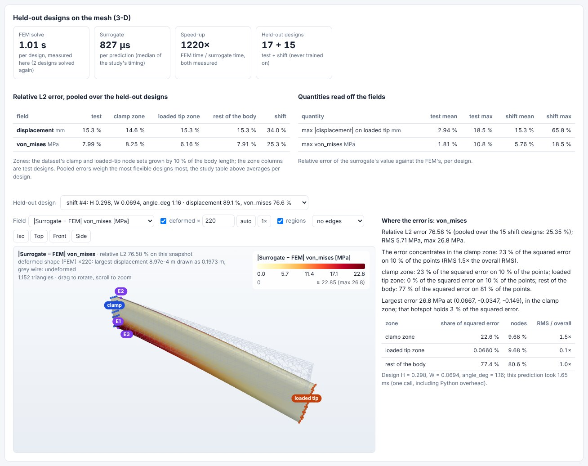
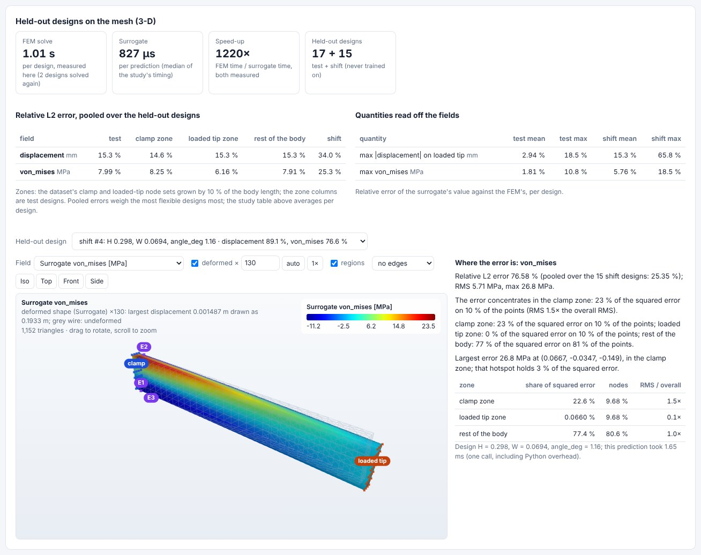
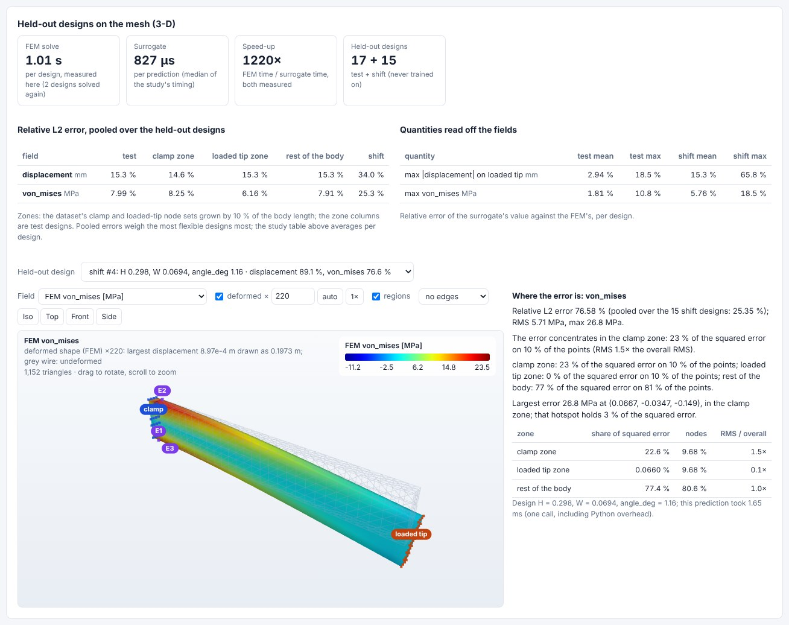

# Surrogate Studio (day 14)

**Live:** https://surrogate.pinneapple.org · **Port:** 8097 · **Prefix:** `SUR`

Turn the simulation results you already have into a fast predictive model, measured on runs it never saw, served
behind a versioned endpoint with its validity range enforced.

## Pain

Every new evaluation needs another run of an expensive solver (CFD, FEA, a thermal model). A surrogate answers in
microseconds, but only if someone picks the right method, tests it honestly on data it did not train on, and says
where it stops being valid. Most teams skip the last two.

## Input

- A table of runs: CSV, Parquet, JSON, HDF5 or NPZ, one row per run. Inputs are the parameters you set; outputs are
  scalars (`Cl`, `Rth`, `pressure_drop`) or a field stored as columns `u_0, u_1, ...` with its grid shape (and
  optionally coordinate names and ranges).
- A `DatasetSpec` (`pinneapple_data.contracts`, embedded in Parquet / HDF5 or as a `.contract.json` sidecar) sets the
  column roles, so the output of the Campaign Planner or the Workflow Runner goes straight in.
- Optional: a group column (geometry or case id, held out whole), a declared PDE (enables the PINN), constraints
  (`Cd > 0`), the budget per method, seeds, the endpoint name and the out-of-distribution policy.
- Or **Try with an example**, offline in about 10 s: the OpenFOAM airfoil campaign of the zoo (scalars, whole airfoils
  held out) or exact viscous Burgers fields (fields + PDE, the steepest fronts held out).

## Output

- An equal-budget comparison of every applicable method on the same splits: validation, held-out test and
  distribution-shift error, spread over seeds, training time, inference time per query, parameter count.
- The chosen model (by validation error; the test and shift sets never choose), hosted at once at
  `/v1/models/<name>/predict` with the Model Gateway's API: versions, OOD gate per query (warn or refuse), run log,
  latency / count / error metrics.
- A limitations report: validity bounds, the OOD gate and how the errors of flagged runs compare, the error per input
  quartile (where it concentrates), the worst runs, the extrapolation ratio, and for fields the error map and the
  PDE residual of the predictions.
- A trust decision (APPROVED / REVIEW / REJECT, `pinneapple_analysis.trust.TrustReport`) with every check and its
  value; a REJECT model is hosted in the `development` stage only.
- Downloads: `study_result.json`, `model_ref.json`, `dataset_spec.json` (the shared contracts), `report.md`,
  `study.json`, `model.zip` and, for PyTorch models, `model.onnx` and `model.pt` (TorchScript).

## 3-D case: a solid FEM cantilever

The example **3-D solid FEM cantilever** is the ROM Lab's data: 100 solid-FEM cantilevers (height, width and load
angle on a Latin hypercube), with the displacement and the von Mises stress on the 31 × 4 × 7 node lattice. It is
loaded as one field dataset with four channels (ux, uy, uz, von Mises; `pinneapple_analysis.surrogate.from_snapshots`).
The study runs the methods that apply: ridge, Gaussian process (on POD modes), MLP and DeepONet. FNO and the tree
ensembles say why they do not. The 15 designs with the smallest load angles are held out as the shift. The results
page adds a panel with:

- **Speed-up, measured.** The FEM solve time is measured on this machine: the example solves two stored designs
  again and checks that they reproduce the stored stress. The surrogate's time is the study's median per
  prediction, and the speed-up is their ratio.
- **Held-out errors per field and per zone.** These are relative L2, pooled over the test designs and over the shift
  designs. The zones are the clamp and loaded-tip node sets grown by 10 % of the length, and the rest of the body.
- **Quantities read off the fields:** the largest displacement on the loaded tip and the largest von Mises stress.
  For each, the relative error per held-out design (mean and max).
- **A held-out design on its body.** Pick any test or shift design to see the surrogate field, the FEM reference and
  |surrogate − FEM|, each with a colour bar and on the deformed shape. The clamp and load sets and the error
  hotspots are marked, and a short text says where the error concentrates against the pooled held-out number.

The view and the error maps are the library's: `pinneapple_neural.architectures.rom.views.prediction_view`, shared
with the ROM Lab, and `pinneapple_analysis.surrogate.heldout.heldout_report`. The page uses the shared viewer
`/shared/fieldview3d.js`. Routes: `GET /api/studies/{id}/view3d?split=test|shift&k=` and `/view3d.glb`.

In one run here (Gaussian process chosen):

- the FEM took 1.01 s per design and the surrogate 0.83 ms per prediction, a speed-up of about 1,220×;
- pooled over the 17 test designs, the relative L2 error was 15.3 % on the displacement and 8.0 % on the von Mises
  stress;
- pooled over the 15 shift designs, it was 34 % and 25 %;
- the tip displacement was within 2.9 % on average over the test designs (18.5 % at worst).

The timings vary from run to run on a shared machine (0.87 to 1.11 s for the FEM over seven runs of the example). The worst shift
design (load angle 1.2°) shows what extrapolation costs: 77 % error on the stress, and negative von Mises values
from the surrogate, which no FEM can produce.







## Integrations

scikit-learn (ridge, Gaussian process, gradient boosting), XGBoost (optional), PyTorch (MLP, FNO, DeepONet, PINN),
ONNX and TorchScript export, CSV / Parquet / HDF5 / NPZ, the shared contracts (DatasetSpec in, ModelRef and
StudyResult out), REST and Python. JAX is not used.

## Methods (PINNeAPPle)

`pinneapple_analysis.surrogate.run_study`: candidate selection with a reason for each method that does not apply
(fields vs scalars; FNO and DeepONet for fields; a PINN only with a declared PDE; GP up to 2000 samples), equal compute
per method (`pinneapple_analysis.cost.equal_budget`), held-out and distribution-shift splits (`make_splits`),
limitations and OOD gate (`limits`), trust report; `pinneapple_registry.ModelGateway` and `gateway_api` for hosting;
`pinneapple_analysis.surrogate.contracts` for the contracts.

## API

| Route | What |
|---|---|
| `POST /api/uploads` | upload a table (shared runtime) |
| `POST /api/inspect` | columns, fields and suggested roles of a table |
| `POST /api/studies` | start a study (`{"example": ...}` or `{"upload_id", "inputs", "outputs", ...}`); a job |
| `GET /api/jobs/{id}`, `/logs` | progress and result (shared runtime) |
| `GET /api/studies/{id}/files/{name}` | downloads |
| `GET /api/studies/{id}/view3d?split=&k=`, `/view3d.glb` | a held-out design of a mesh study (the 3-D cantilever) on its body: FEM, surrogate, error |
| `GET /v1/models`, `POST /v1/models/{name}/predict`, `/runs`, `/v1/metrics`, `.../export/{fmt}` | the hosted models |

Interactive documentation at `/docs`.

## Monetization

Paid training (budget and seeds beyond the free tier, larger tables), metered inferences on hosted models, private
model hosting with API keys, and enterprise deployments next to the customer's solver data.

## Limits

- Errors are measured on held-out runs of the same campaign; another solver setting, mesh or physics regime is not
  covered. The OOD gate looks at the inputs only.
- Each method runs with its library defaults (no per-method hyper-parameter search), so a tuned method may do better.
- The physics checks are the declared PDE residual (finite differences on the grid) and declared constraints;
  conservation and boundary conditions of outputs are not checked here (use `pinneapple check`).
- FNO here takes parameters as constant input channels on 1-D or 2-D uniform grids; irregular meshes are not
  supported. Gaussian processes are limited to 2000 training samples.
- The 3-D view needs the node lattice of a structured mesh (`from_snapshots`). It runs for the cantilever example;
  uploaded tables keep the 1-D and 2-D field maps. Nothing constrains the predicted von Mises stress to be positive.
- Hosted models are visible to everyone who can reach the server; use the login or `SUR_REQUIRE_API_KEY=1`.
- Thread jobs are cancelled at their next progress report; `SUR_JOB_EXECUTOR=process` kills them at once.

## Run locally

```bash
pip install -e ".[surrogate]" -r apps/surrogate_studio/requirements.txt
cd apps/surrogate_studio && uvicorn surrogate_studio.api:app --port 8097
```
