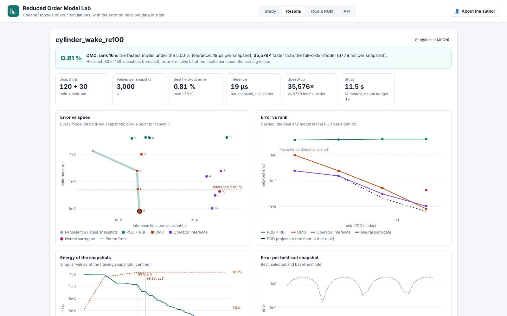
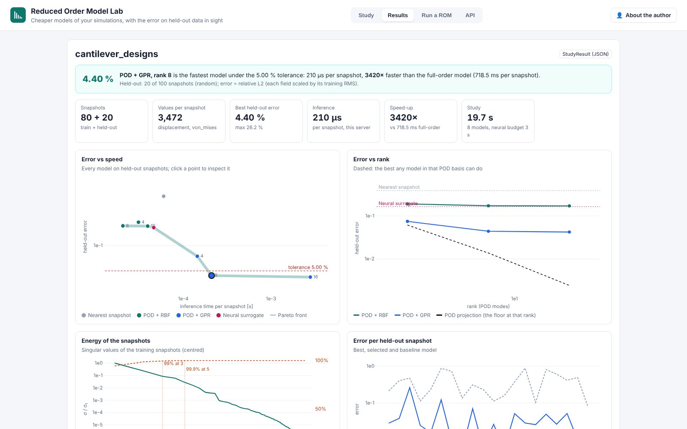

# Reduced Order Model Lab (day 19)

**Cheaper models of your simulations, with the error on held-out data in sight.** Live at
<https://rom.pinneapple.org>. Source: [`apps/rom_lab`](https://github.com/PINNeAPPle-Labs/PINNeAPPle/tree/main/apps/rom_lab).

Upload snapshots of one mesh (OpenFOAM times, VTU/VTK/FRD series, NPZ/HDF5 arrays, a CSV/Parquet table). The lab
fits POD + RBF, POD + GPR, DMD, Operator Inference and a neural surrogate at equal wall-clock budget, at several
ranks, and scores each on snapshots it never saw: later times (a forecast), interleaved times, or unseen designs. It
shows the energy of the singular values, error vs rank against the POD projection floor, error vs inference time with
the Pareto front, the speed-up over the full-order model, and the reconstruction of any held-out snapshot.

## Export and chain

- `.rom.npz`: arrays and a JSON manifest, no pickle; `ReducedModel.from_bytes(b).predict(times=...)`.
- ONNX (POD + RBF, nearest, parametric neural, DMD) plus the `spec` for `ModelGateway.publish(kind="onnx")`.
- `ModelRef` per model (held-out metrics, split, training range, SHA-256) and a `StudyResult` for the study.

## Limits

Snapshots must share one mesh; time steppers need a uniform step and are not validated outside the training window;
no physics check runs on the reduced fields (`ModelRef.trust_decision = UNCHECKED`). See the app README.

Monetization: building, exporting and running reduced models.
