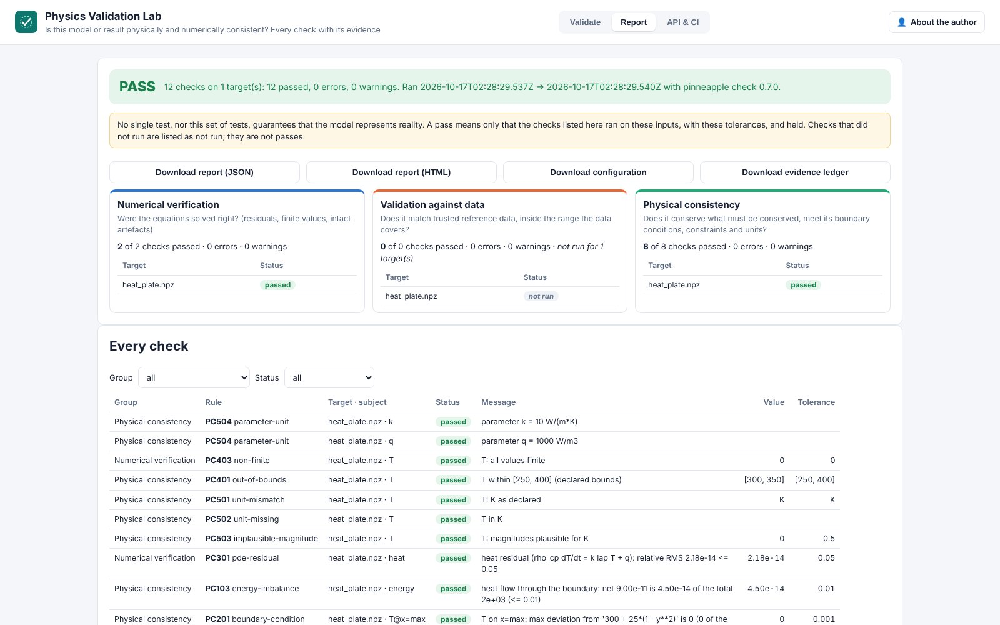

# Physics Validation Lab (day 24)

**Is this model or result physically and numerically consistent?** Live at <https://validate.pinneapple.org>.
Source: [`apps/validation_lab`](https://github.com/PINNeAPPle-Labs/PINNeAPPle/tree/main/apps/validation_lab).

Upload predictions or simulation results. Describe the equations, parameters, units, bounds, boundary conditions
and reference data in a form, or upload a [`pinneapple check`](../guides/physics_checks_in_ci.md) configuration,
or reference a zoo model with query points. The lab runs the physics checks and reports them in three groups that
answer different questions:

| Group | Question |
|---|---|
| Numerical verification | Were the equations solved right? Residuals, finite values, intact artefacts, method status |
| Validation against data | Does it match trusted data, inside the range the data covers? Reference error, QoIs, out-of-range queries |
| Physical consistency | Conservation, boundary and initial conditions, bounds and constraints, units |

For each target, the report says which groups did not run (for example, no reference means no validation against
data). Each check that ran has an evidence record: the SHA-256 of its inputs, its outputs, and start and finish
times ([evidence ledger](../guides/evidence_ledger.md)). The report also holds the configuration and the hash of
every input file, so `pinneapple check --config pinneapple-check.toml` reproduces it.

No single test guarantees that a model represents reality, and neither does this set of tests. A pass means only
that the listed checks ran and held on these inputs, with these tolerances.

## Automate it

- `POST /api/validate` takes files plus `config` (TOML) or `spec` (JSON) and returns the report. The interactive
  docs are at `/docs`.
- In CI, the GitHub Action `PINNeAPPle-Labs/PINNeAPPle@main` runs the same checks on every pull request.
- The report JSON, with its ledger, feeds the Engineering Evidence Report (day 30).

## Limits

- Python models and checkpoints are not run on the server. Upload their predictions, or use the Action.
- The default tolerances of `pinneapple check` decide pass or fail unless you set them per target.
- The report is `pinneapple-validation-lab/v1`. Export to `validation-report/v1` (`pp.validate`) and its credibility
  levels will follow once those PRs are merged.

Monetization: validations per model, dataset or version, with private projects and CI history for teams.
