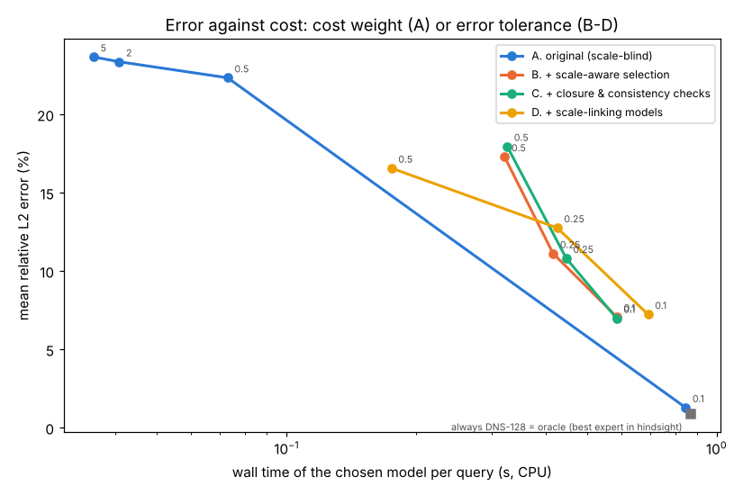
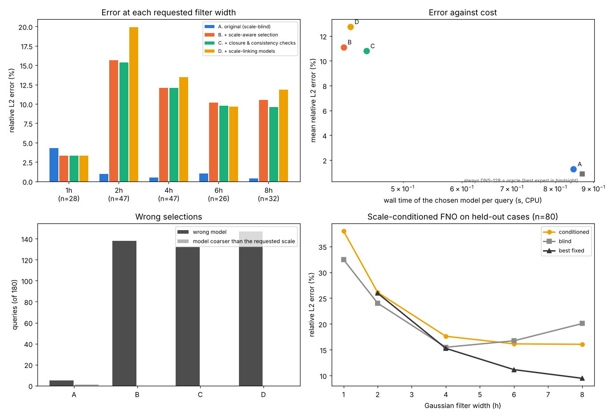
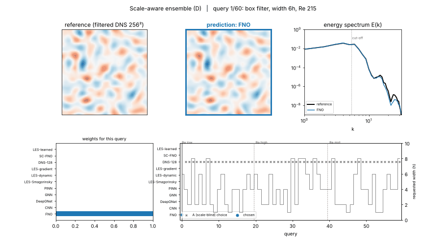

# Multiscale ensembles: scales, filters and closures

An adaptive ensemble ([Adaptive ensembles of physics models](physics_ensembles.md)) picks a model from the errors
it made and the physics of the current case. In turbulence that is not enough. Every model answers at a *scale*:

- a surrogate is trained on fields at one resolution, with one implicit or explicit filter;
- an LES resolves the field down to its filter width and models the rest with a closure;
- a DNS resolves everything down to the dissipation scale.

A question asks for a scale too: the field filtered at some width, a spectrum up to some wavenumber, a time scale. A
model that does not resolve those scales cannot answer, however small its validation error. And when it can answer,
its output is filtered in a particular way, which the question may not share.

`pinneapple_physics.multiscale` deals with filtering and closure first and explicitly, then uses the scales to
choose models. It is plain numpy, except `multiscale.learned` (PyTorch).

| Module | Contents |
|---|---|
| `filters` | box, Gaussian and sharp spectral filters with exact transfer functions; restriction and prolongation between grids; post-filtering from one width to another and how much of the target filter it can reach; filters whose width varies in space, and their commutation error |
| `ns2d` | pseudo-spectral 2-D vorticity DNS and LES (ETDRK4, 2/3 dealiasing), energy spectrum, residual of the vorticity equation |
| `closures` | Smagorinsky, dynamic Smagorinsky, gradient (Clark) model; a-priori and a-posteriori tests; label-free closure health |
| `residuals` | residuals of the *filtered* equations at several widths, split into subfilter, commutation and model parts |
| `consistency` | cross-scale consistency: the fine prediction, filtered, against the coarse one |
| `scales` | `ScaleProfile`, `ScaleQuery`, `scale_compatibility`, `ScaleAwareRouter` with a fidelity ladder |
| `learned` | scale-conditioned FNO with a filtering-consistency loss; differentiable LES; closure trained a posteriori |
| `viz` | animation of a run: requested scale, chosen model, spectra, weights |

## Filters

A filter of width Δ acts on each Fourier mode through its transfer function. On a periodic grid it is applied
mode by mode, so the transfer function is exact to round-off (tested on single modes). Filters with a uniform width
commute with derivatives. In 2-D the filter is the tensor product of the 1-D filters.

| kind | transfer function Ĝ(k) | remarks |
|---|---|---|
| box | sin(kΔ/2) / (kΔ/2) | top-hat average; changes sign, with zeros at k = 2πn/Δ |
| Gaussian | exp(−k²Δ²/24) | same second moment as the box; positive; two Gaussians compose (Δ² = Δ₁² + Δ₂²) |
| sharp | 1 for \|k\| ≤ π/Δ, else 0 | spectral cut-off; idempotent |

```python
from pinneapple_physics.multiscale import Filter, apply_filter, refilter, realizability_mismatch, restrict

g = Filter("gaussian", 0.2)
w_bar = apply_filter(w, g)                              # periodic, last two axes
w_coarse = restrict(w_bar, 32)                          # Fourier restriction: integrals preserved to round-off
w_wide = refilter(w_bar, g, Filter("gaussian", 0.5))    # exact: a wider Gaussian from a narrower one
realizability_mismatch(Filter("sharp", 0.3), Filter("gaussian", 0.3), kmax=32)   # > 0: content beyond the cut-off is lost
```

`refilter(u, source, target)` applies `Ĝ_target / Ĝ_source` where that ratio is at most 2. Beyond that ratio the
scales are treated as lost: recovering them would only amplify the source's errors.
`realizability_mismatch` measures, weighted by a model spectrum, how much of the target filter cannot be reached.
The router uses it.

`filter_variable_width(u, kind, delta_field)` and `commutation_error(u, kind, delta_field, axis)` handle a width that
varies in space. The commutation error `∂(ū)/∂x − (∂u/∂x)‾` is zero to round-off for a uniform width and non-zero
otherwise (Ghosal & Moin 1995). A residual of the filtered equations picks it up from filtering alone, so it must not
be blamed on the model.

## Closures and how to test them

Filtering the momentum equations leaves the subfilter stress `τᵢⱼ = (uᵢuⱼ)‾ − ūᵢūⱼ`. In 2-D vorticity form the
filtered equation gets the tendency `−curl(div τ) = −div σ`, with the subfilter vorticity flux
`σⱼ = (uⱼω)‾ − ūⱼω̄`. Each closure below is a callable `closure(omega, solver) -> tendency` for
`VorticityNS2D(n, nu, closure=...)`, with a `stress(omega, solver)` method:

| closure | model | reference |
|---|---|---|
| `Smagorinsky(cs=0.17)` | τ = −2 (C_s Δ)² \|S̄\| S̄ | Smagorinsky 1963; Lilly 1967 |
| `DynamicSmagorinsky()` | coefficient from the Germano identity between grid and test filter, least squares, domain average, clipped at 0 | Germano et al. 1991; Lilly 1992 |
| `GradientModel()` | τ = Δ²/12 ∂ₖūᵢ ∂ₖūⱼ | Clark, Ferziger & Reynolds 1979 |
| `learned.LearnedClosure` | periodic CNN that returns the flux σ, so the tendency −div σ conserves circulation | trained a posteriori, see below |

Tests:

- `apriori_test(w_fine, filter, closure, n_coarse)` filters a resolved field and compares the closure, computed
  from the filtered field, with the exact subfilter terms. It reports the correlation of the stress components and
  of the tendency, the mean subfilter energy transfer `Π = −τᵢⱼS̄ᵢⱼ`, and the backscatter fraction (Π < 0), which
  no eddy viscosity can represent.
- `aposteriori_test(les, w0_bar, ref_bar, times)` runs the LES from the filtered initial field. It returns the
  energy-spectrum error, the field error, the resolved-energy dissipation rate against the reference, the long-run
  stability and the enstrophy growth.
- `closure_health(w_les, w0_bar, kc, closure=..., solver=...)` needs no reference, so it can run in operation:
  - the field must stay finite;
  - resolved enstrophy must not grow in unforced 2-D flow. Advection conserves enstrophy, and viscosity and the
    forward enstrophy cascade only remove it;
  - the spectrum near the cut-off must not pile up or collapse against the power law of the resolved range;
  - the Germano-identity error `germano_error` must stay below 1.05. This error is the resolved stress between the
    grid filter and a test filter, as the closure predicts it, compared through the tendency it produces: 1 means
    no better than no model, above 1 means worse than no model.

A 2-D result to keep in mind: for Gaussian and box filters the leading-order subfilter stress is
`τ ≈ Δ²/12 ω (−S̄₁₂, S̄₁₁)`, the strain rotated by 45° times the vorticity. It is orthogonal to S̄, so an eddy-viscosity
stress has near-zero correlation with the true stress (measured −0.03 to 0.00 below), the gradient model has 0.97 to
0.99, and the gradient model's mean energy transfer is zero. The vorticity tendency, which is what the resolved
equation sees, correlates 0.1 to 0.4 for all of them. Stress correlations of 0.3 to 0.4, quoted for Smagorinsky in
3-D channel flow, do not carry over to 2-D.

## Multiscale residuals

```python
from pinneapple_physics.multiscale import ns2d_multiscale_residuals, Filter

r = ns2d_multiscale_residuals(w_t0, w_t1, dt, nu, [Filter("gaussian", d) for d in (0.1, 0.2, 0.4)],
                              subfilter="exact")      # or "dynamic", a closure, or None
print(r.to_markdown())                                # raw | subfilter | commutation | model, per width
```

The residual of an exact field, filtered, is the subfilter term, not a model error. The table splits it:
`raw = subfilter + commutation + model`. For a resolved DNS pair (64², ν = 10⁻³, Gaussian filters), the model
part is 10 % of the raw residual at Δ = 0.2 and 0.3 % at Δ = 0.4. On an exact steady Taylor-Green vortex every part is zero at every width. With white
noise added, the residual follows the filter's transfer function (`sqrt(mean Ĝ²)`), as the tests check.
`multiscale_residuals(state, residual_fn, filters, subfilter_fn=..., commutation_fn=...)` is the generic version for
any equation.

## Cross-scale consistency

```python
from pinneapple_physics.multiscale import cross_scale_consistency

rep = cross_scale_consistency(fine, coarse, coarse_filter=Filter("sharp", L / 16), tol=0.05, gci=None)
rep.passed, rep.field_error, rep.spectrum_error, rep.failed      # e.g. ['circulation (mean)']
```

The fine prediction is refiltered and restricted to the coarse grid. It is then compared with the coarse prediction
on the field, on the spectrum over the shared wavenumbers, and on integrals (circulation, energy, enstrophy, or any
`{name: fn}`). Tolerances can be scaled by a known discretisation error (`gci`). Restricting an exact field keeps
its integrals to round-off. A 32² solver started from the same state as a 64² solver passes. The same 32² solver with
a biased source term fails, and the report names the broken integral, `circulation (mean)`. In the ensemble, the
scale-conditioned FNO checks itself this way: its prediction at Δ, filtered to 2Δ, against its prediction at 2Δ.

## Scale-aware selection and adaptive fidelity

```python
from pinneapple_physics.ensemble import PhysicsEnsemble
from pinneapple_physics.multiscale import ScaleAwareRouter, ScaleProfile, ScaleQuery, Filter

profiles = [
    ScaleProfile("fno", Filter("gaussian", 2 * h), h, re_range=(150, 300), fidelity=0),
    ScaleProfile("les_dynamic", Filter("sharp", pi / 16), L / 48, closure="dynamic Smagorinsky", fidelity=1),
    ScaleProfile("dns", Filter("sharp", 0.0), L / 128, re_range=(0, 6000), fidelity=2),
]
router = ScaleAwareRouter(profiles, query_fn=lambda case: ScaleQuery(case["filter"], re=case["re"]))
ens = PhysicsEnsemble(experts, mode="select", router=router,
                      prediction_checks={"les_dynamic": lambda pred, case: les_health(pred, case)})
router.route(ScaleQuery(Filter("sharp", h / 4), re=3000)).reasons[0]   # 'not covered: ... a resolved solver ...'
```

For each case:

1. Models whose resolved width (filter width or grid spacing) is larger than the requested width sleep. So do
   models whose time step is longer than the requested time scale.
2. Every other model gets a compatibility of `exp(−(mismatch/0.25)²)` times a Reynolds-range score, where mismatch
   is the realizability mismatch of the requested filter from the model's own output filter. This compatibility is a
   prior on the learned weights.
3. Fidelity ladder: only the lowest rung with a compatible model (≥ 0.3) is awake. A question about small scales
   goes straight to the solver; a question about large scales stays on the surrogates.
4. Prediction checks: the label-free closure health of each LES and the consistency check of the scale-conditioned
   FNO. A failing model is left out of the case, and when every model on the rung fails the ensemble moves up a rung.
5. The residual look-ahead uses the residual of the filtered equations with the subfilter term removed, at the
   requested width and at twice it.

## Models that connect scales

- `learned.ScaleConditionedFNO2d(conditioned=True)` takes Δ as input: FiLM modulation of every Fourier layer by
  log Δ. It is trained on one dataset filtered at several widths with `fit_scale_conditioned`. The
  `filtering_consistency_loss` makes its prediction at Δ₁, filtered to Δ₂, equal its prediction at Δ₂.
  `conditioned=False` gives the scale-blind network for comparison.
- `learned.TorchVorticityLES2D` + `LearnedClosure` + `train_closure_aposteriori`: the closure is trained *through
  the solver*. The LES is rolled out 60 steps, the loss compares its trajectory and spectra with the filtered DNS,
  and the gradient goes through every step. `as_numpy_closure` plugs the result into `VorticityNS2D`.

## Experiment: decaying 2-D turbulence with shifting Reynolds number and requested scale

`examples/physics_ensemble/multiscale_turbulence.py` (benchmark: `multiscale.turbulence.DecayingTurbulence2D`).

**Case.** 2-D decaying turbulence on [0, 2π)² at three Reynolds bands, Re = 1/ν = 150-300, 700-1400 and
2800-5000. Each case starts from a random field with its energy spectrum peaked at k = 6, run for 0.5 time units so
the cascade develops. A query gives that state and asks for the vorticity 0.28 and 0.30 time units later, filtered
at a requested width Δ/h ∈ {1, 2, 4, 6, 8} (h = 2π/64) with a box, Gaussian or sharp filter, on a 64² grid. The
independent reference is a 256² DNS filtered at that width. Training data come from a separate 128² DNS
(600 cases).

**Query streams.** Three seeds of 60 queries each, 180 in all. The Reynolds regime shifts low → high → mid. The
width and the filter are drawn per query. The initial states are never in training, and the width 6h is not used
to train any model.

**Experts.**

| Expert | Filter of its output | Re range | How it was built |
|---|---|---|---|
| FNO | Gaussian 2h | 150-300 | supervised |
| CNN | Gaussian 4h (32²) | 2800-5000 | supervised |
| DeepONet | sharp 8h | 700-1400 | supervised |
| MeshGraphNet | box 4h (24² torus graph) | 700-1400 | supervised |
| PINN | sharp 8h | 150-300 | Fourier-Galerkin physics loss only |
| LES 48², three variants | sharp, k ≤ 16 | any | Smagorinsky (C_s 0.17), dynamic Smagorinsky, gradient model |
| DNS | 128² | ≤ 6000 | resolved solver |
| SC-FNO | Gaussian 2h..8h (Δ is an input) | 700-5000 | scale-conditioned, with the filtering-consistency loss |
| LES-learned | sharp, k ≤ 16 | 700-5000 | closure trained a posteriori through the solver |

**Configurations.** A is the original ensemble: scale-blind, it filters every output again with the requested
filter, and it learns from past errors plus the residual look-ahead. B adds the scale-aware router, realizable
post-filtering, and the fidelity ladder with an error tolerance. C adds the closure and consistency checks and the
closed multiscale residual. D adds the two scale-linking experts.

Each configuration has a cost/accuracy setting: the weight of the cost for A, the tolerance for B-D. The table
sweeps it over all 180 queries.

| Configuration (setting) | Error, all | Error, 1h (n=28) | Error, 2h (n=47) | Error, 4h (n=47) | Error, 6h (n=26) | Error, 8h (n=32) | Spectrum error | Above 25 % | Coarser than asked | Cost of chosen model (s) | Share sent to the DNS |
|---|---|---|---|---|---|---|---|---|---|---|---|
| A, cost weight 0.1 | 1.3 % | 4.3 % | 1.0 % | 0.5 % | 1.0 % | 0.4 % | 0.005 | 1 | 1 | 0.85 | 97 % |
| A, cost weight 0.5 | 22.3 % | 32.1 % | 27.0 % | 19.9 % | 16.8 % | 15.1 % | 0.199 | 57 | 25 | 0.073 | 4 % |
| A, cost weight 5 | 23.7 % | 36.0 % | 29.6 % | 20.0 % | 16.8 % | 15.1 % | 0.326 | 61 | 29 | 0.036 | 0 % |
| B, tolerance 0.1 | 7.1 % | 3.3 % | 4.8 % | 7.9 % | 9.7 % | 10.4 % | 0.021 | 6 | 0 | 0.59 | 42 % |
| C, tolerance 0.1 | 7.0 % | 3.3 % | 4.8 % | 7.8 % | 9.4 % | 10.1 % | 0.018 | 6 | 0 | 0.59 | 42 % |
| D, tolerance 0.1 | 7.2 % | 3.3 % | 6.2 % | 8.3 % | 7.6 % | 10.3 % | 0.018 | 5 | 0 | 0.69 | 34 % |
| B, tolerance 0.25 | 11.1 % | 3.3 % | 15.6 % | 12.1 % | 10.2 % | 10.5 % | 0.031 | 11 | 0 | 0.42 | 23 % |
| C, tolerance 0.25 | 10.8 % | 3.3 % | 15.4 % | 12.1 % | 9.8 % | 9.6 % | 0.025 | 16 | 0 | 0.45 | 24 % |
| D, tolerance 0.25 | 12.8 % | 3.3 % | 19.9 % | 13.5 % | 9.7 % | 11.9 % | 0.032 | 15 | 0 | 0.43 | 16 % |
| B, tolerance 0.5 | 17.3 % | 3.3 % | 22.8 % | 16.3 % | 18.6 % | 21.8 % | 0.057 | 42 | 0 | 0.32 | 16 % |
| C, tolerance 0.5 | 17.9 % | 3.3 % | 25.2 % | 16.2 % | 18.6 % | 22.1 % | 0.055 | 54 | 0 | 0.33 | 16 % |
| D, tolerance 0.5 | 16.6 % | 3.3 % | 24.5 % | 16.8 % | 14.9 % | 17.5 % | 0.056 | 52 | 0 | 0.18 | 16 % |
| Always the DNS (also the best expert in hindsight) | 0.9 % | | | | | | | | | 0.87 | 100 % |

Errors are relative L2 against the filtered reference. The spectrum error is the mean |log₁₀ E/E_ref| up to the
requested cut-off. "Above 25 %" counts queries whose error is above 25 %. "Coarser than asked" counts queries
answered by a model whose resolved width is larger than the requested one. Costs are median CPU wall times.



What the numbers say:

- **The scale-blind ensemble does not know when it cannot answer.** With any weight on cost it moves from the DNS
  to the surrogates for every query, including the finest ones. It then answers 25-29 queries with a model coarser
  than the request, and its error at the finest width is 32-36 %. The scale-aware configurations never answer below
  a model's resolved scale, and keep 3.3 % at 1h at every tolerance, because those queries go to the DNS. Their
  tolerance gives operating points between "always DNS" and "always surrogate" (7 % error at 0.59 s, 17 % at
  0.18-0.33 s), which the cost weight of A does not reach: it jumps from 1.3 % to 22 %.
- **In mean error per unit cost they do not beat the scale-blind ensemble here.** On this small 2-D problem on a
  CPU, the 128² DNS costs 0.87 s, about the same as an LES with the dynamic or learned closure (1.2-1.5 s with
  closure overhead), so the LES rung saves nothing. The DNS is also the best model on almost every query. With 3-D
  turbulence, where an LES is orders of magnitude cheaper than a DNS, the ladder pays off; this experiment does not
  show that.
- **The closure checks work on the closure that is wrong.** The label-free check flags static Smagorinsky
  (C_s = 0.17) on all 180 queries. Its Germano-identity error is 1.35, worse than no model, and a posteriori it
  dissipates 1.5×, 3.5× and 7.9× too much resolved energy in the low, mid and high bands. The check never flags the
  dynamic, gradient or learned closures, which are not over-dissipative here. The gradient model did not become
  unstable before t = 2 in these cases, so nothing was flagged for it. C's gain over B is small (10.8 % against
  11.1 % at the 0.25 tolerance; the same at 0.1), because the Smagorinsky LES was rarely the model chosen anyway.
- **The scale-linking models are mixed.**
  - The closure trained a posteriori is the best LES in every band. Its spectrum error is 0.008-0.013 against
    0.038-0.052 for the classical closures. Its field error is 10-18 % against 17-37 %, and its dissipation ratio is
    0.98-1.41.
  - The scale-conditioned FNO beats the scale-blind network at large widths: 16.1 % against 16.7 % at the held-out
    6h, and 16.1 % against 20.1 % at 8h.
  - But it loses to separate fixed-width FNOs post-filtered exactly: 11.2 % at 6h, 9.5 % at 8h. #604's acceptance
    criterion is therefore **not met**.
  - In the ensemble, D gives the cheapest point at the 0.5 tolerance (0.18 s, 16.6 %) and no gain elsewhere.

Closures on held-out cases (8 per band, LES 48², sharp filter k ≤ 16, a posteriori to t = 0.3, stability to t = 2):

| Re band | Closure | Stress corr. | Tendency corr. | Germano error | Spectrum error | Field error | Dissipation LES/DNS | Flagged |
|---|---|---|---|---|---|---|---|---|
| low | no model | | | | 0.039 | 17.0 % | 0.99 | 0 % |
| low | Smagorinsky 0.17 | -0.00 | 0.13 | 1.37 | 0.047 | 17.3 % | 1.55 | 100 % |
| low | dynamic Smagorinsky | -0.00 | 0.13 | 1.00 | 0.038 | 16.8 % | 1.02 | 0 % |
| low | gradient | 0.29 | 0.20 | 0.97 | 0.040 | 19.5 % | 0.99 | 0 % |
| low | learned, a posteriori | | 0.32 | | **0.008** | **10.1 %** | 0.98 | 0 % |
| mid | no model | | | | 0.046 | 28.0 % | 0.91 | 0 % |
| mid | Smagorinsky 0.17 | -0.00 | 0.15 | 1.36 | 0.055 | 26.4 % | 3.47 | 100 % |
| mid | dynamic Smagorinsky | -0.00 | 0.15 | 1.00 | 0.044 | 27.7 % | 1.00 | 0 % |
| mid | gradient | 0.32 | 0.21 | 0.98 | 0.051 | 33.3 % | 0.88 | 0 % |
| mid | learned, a posteriori | | 0.34 | | **0.011** | **16.3 %** | 1.07 | 0 % |
| high | no model | | | | 0.046 | 31.1 % | 0.62 | 0 % |
| high | Smagorinsky 0.17 | 0.00 | 0.15 | 1.35 | 0.051 | 28.9 % | 7.94 | 100 % |
| high | dynamic Smagorinsky | -0.00 | 0.15 | 1.00 | 0.045 | 30.8 % | 0.88 | 0 % |
| high | gradient | 0.33 | 0.20 | 0.99 | 0.052 | 37.0 % | 0.46 | 0 % |
| high | learned, a posteriori | | 0.32 | | **0.013** | **18.3 %** | 1.41 | 0 % |

The true backscatter fraction (Π < 0) is 0.49 in every band. The eddy viscosities have none; the gradient model
has 0.46-0.48. In 2-D the dynamic coefficient comes out almost zero, so dynamic Smagorinsky behaves like no model.
The field errors at t = 0.3 are dominated by the loss of correlation of the small scales, which a closure cannot
recover. The spectrum is the measure that tells the closures apart.

Scale-conditioned FNO on held-out cases (n = 80, Gaussian targets; the training widths were 2h, 4h and 8h):

| Width | Scale-conditioned | Scale-blind | Best fixed-width, post-filtered | Spectrum error | Consistency (Δ vs 2Δ) |
|---|---|---|---|---|---|
| 1h (extrapolation) | 38.0 % | 32.5 % | n/a | 0.731 | 18.8 % |
| 2h | 26.1 % | 24.0 % | 26.0 % | 0.077 | 8.9 % |
| 4h | 17.6 % | 15.5 % | 15.3 % | 0.029 | 11.9 % |
| 6h (held out) | 16.1 % | 16.7 % | 11.2 % | 0.034 | |
| 8h | 16.1 % | 20.1 % | 9.5 % | 0.039 | |





**Limits of this experiment.**

- It is 2-D, decaying and small.
- Several surrogates are weak, with CPU-sized training: the DeepONet's relative training MSE was 0.66 and the PINN's
  relative Galerkin residual 0.51.
- The output horizon (0.3 time units, about two eddy turnovers) decorrelates the small scales.
- One training run per model.
- Re-running with more training, a 3-D LES/DNS pair or forced turbulence is the next step.

Every number above is regenerated by `python examples/physics_ensemble/multiscale_turbulence.py`, then
`--stage sweep --seed s` for s = 0, 1, 2, then `--stage sweep-report`.
