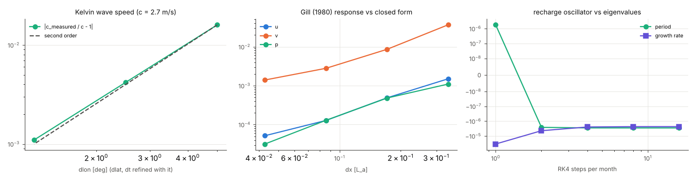
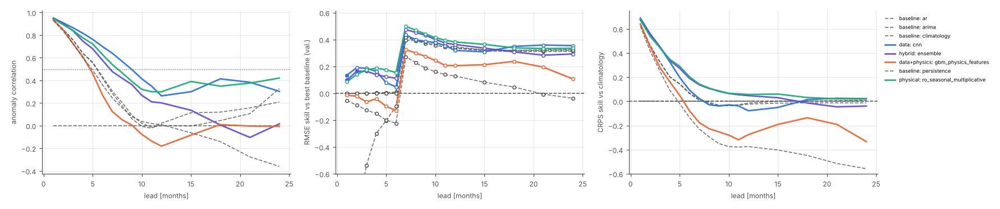
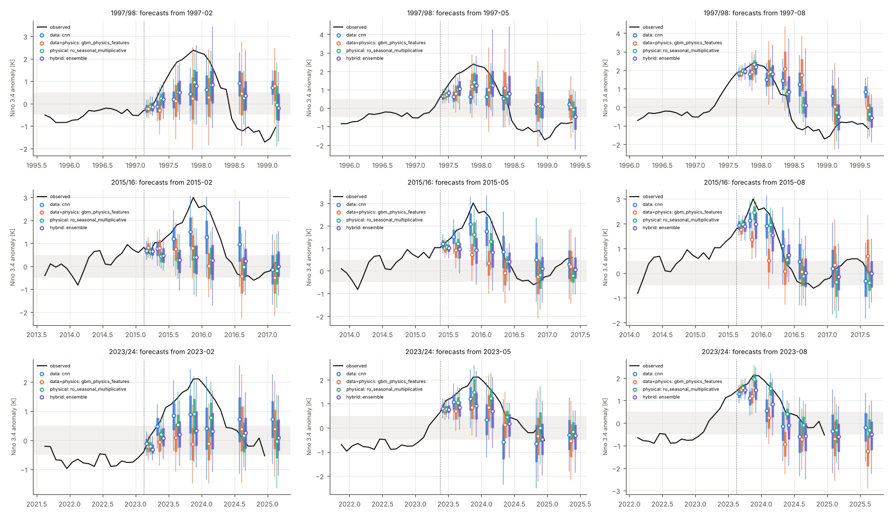
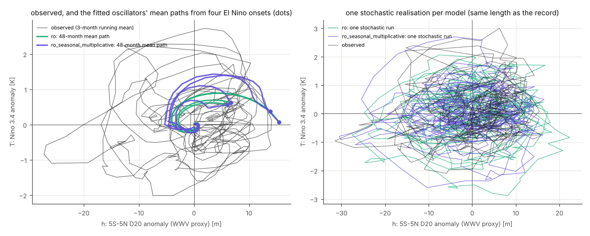
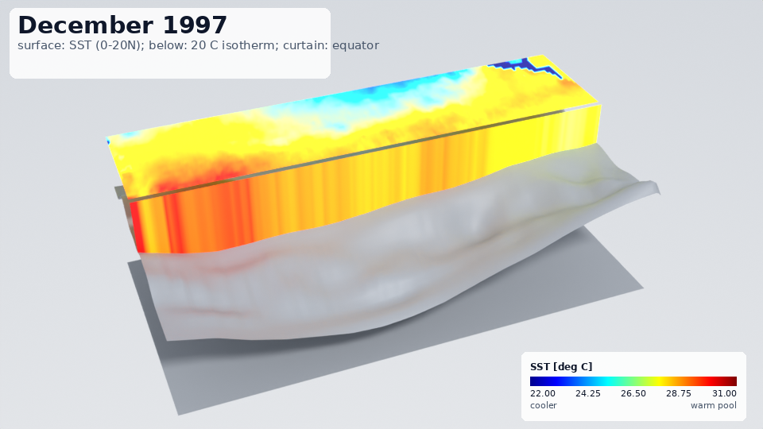

# Predicting El Niño: physical, physics-informed, data-driven and hybrid models under one protocol

This guide compares families of forecasts of the Niño-3.4 sea-surface-temperature (SST) anomaly at leads of 1 to
24 months:

* conceptual physics: the recharge oscillator and the delayed oscillator;
* an intermediate coupled ocean–atmosphere model: an equatorial shallow-water ocean, a Gill atmosphere and an SST
  equation;
* physics-informed networks (PINNs);
* data-driven models, including a CNN on SST maps in the spirit of Ham et al. (2019);
* hybrids: physics plus learned correction, data assimilation with an ensemble Kalman filter, and ensembles.

Every model runs under one protocol, and the guide reports how much skill each one has, measured against the
baselines. Every number below is read from the committed results.

Everything comes from one script, [`examples/enso_forecasting/run_study.py`](../../examples/enso_forecasting/run_study.py).
* Its results are in `examples/enso_forecasting/results/`:
  * `study.json`: the merged zoo, the ENSO scores and the case studies;
  * `tables.md`: generated from the JSON, the source of every table below;
  * `data.json`, `solver_checks.json`, `spring_barrier.json`, `phase.json` and `shallow_water_pinn.json`;
  * `manifests/`: the URL and SHA-256 of every downloaded source file.
* The figures are in `examples/enso_forecasting/figures/`.
* The library code is `pinneapple_systems.time_series.enso`, tested in `tests/test_enso.py`. The protocol, baselines,
  tests and generic forecasters are the ones of `forecast_lab`; see
  [the near-random forecasting guide](near_random_forecasting.md).

{{SUMMARY}}

## Quick start

```python
from pinneapple_systems.time_series.enso import dataset, forecasters as F, study
from pinneapple_systems.time_series.forecast_lab.study import evaluate

ds = dataset.build_dataset()                     # first call streams ~92 GB of source files, keeps ~0.2 GB
data = dataset.to_series(ds)                     # columns: nino34, wwv, h_west, h_east, nino4, nino3, nino12
prot = study.protocol(ds.months)                 # test period from 2012-01, leads 1-12, 15, 18, 21, 24
split = prot.final_split(len(data))
ro = F.RechargeOscillatorForecaster(seasonal=("R", "F1", "F2", "eps"), multiplicative=True)
ro.fit(data, split["train"], split["val"], prot.horizons)
print(evaluate(ro, data, split["test"])["rmse"])
res = study.run_model("lim", data, prot)         # tuning by purged walk-forward CV, test scores, DM tests
```

## Data

All sources are public, openly licensed and need no credentials.

The NOAA servers that publish the usual index files cannot be reached from the environment where this study ran:
* CPC: `sstoi.indices`, ONI, SOI;
* PSL;
* PMEL's WWV file.

The same NOAA data were taken instead from NOAA's open-data buckets on AWS. ERA5 came from WeatherBench 2 on
Google Cloud.

Every file is hashed. Its SHA-256 and URL are in a manifest, committed as `results/manifests/*.json.gz`. Passing
those manifests (the script does) makes a download that does not reproduce a recorded hash fail. Raw files are
reduced and deleted; their hashes stay.

| quantity | source | how it is used |
|---|---|---|
| SST, Niño 3.4 / 3 / 4 / 1+2 | NOAA OISST v2.1 AVHRR-only daily 0.25° (Huang et al. 2021, J. Climate 34:2923; DOI 10.25921/RE9P-PT57), bucket `noaa-cdr-sea-surface-temp-optimum-interpolation-pds`, public domain | every final (not preliminary) daily file of 1981-09 to 2026-09 (16 466 files), averaged per month into 1° cells over 30S–30N, 100E–60W; indices are cos-latitude-weighted box means; maps on the model grid (2° × 1°, 20S–20N, 120E–80W) |
| thermocline (20 °C isotherm depth, D20) | World Ocean Database (Boyer et al. 2018, NOAA Atlas NESDIS 87), bucket `noaa-wod-pds`, public domain: moored buoys (TAO/TRITON), XBT and Argo profiles | D20 of every quality-controlled cast (flags 0) in 8S–8N, binned into 10° longitude bins (130E–80W) per month for 5S–5N and 2S–2N; anomalies; empty bins filled month by month from the observed bins with the 4 leading EOFs of the base period |
| WWV proxy, tilt | the 5S–5N D20 bins | `wwv` = zonal mean D20 anomaly (the region of Meinen & McPhaden 2000, J. Climate 13:3551); `h_west` / `h_east` = means west / east of 155W |
| wind stress, SOI proxy | ERA5 (Hersbach et al. 2020, QJRMS 146:1999) 6-hourly on the 64 × 32 grid of WeatherBench 2 (Rasp et al. 2024, JAMES 16:e2023MS004019), `gs://weatherbench2`, Copernicus licence (free use and redistribution with attribution; contains modified Copernicus Climate Change Service information) | bulk stress τ = ρ C_D \|U\| U (C_D = 1.3e-3) from every 6-hourly 10 m wind, monthly means 1959-01 to 2022-12; Tahiti–Darwin pressure index at the nearest cells |
| cross-checks | NCEI 0–700 m heat content, 3-month means 1955–2020 (Levitus et al. 2012, GRL 39:L10603; bucket `noaa-cdr-ocean-heat-content-pds`); the statsmodels El Niño data set (Niño 1+2 SST 1950–2010, NOAA CPC) | correlations below |

Not used, and why:
* **GODAS / ORAS5 thermocline fields.** No credential-free route was reachable from here (PSL is blocked; the ORAS5
  files on AWS are model initial conditions only). The thermocline comes from the in-situ casts instead.
* **The station SOI.** The CPC file cannot be reached; the ERA5 pressure index is a proxy of it.
* **ERA5 after 2022-12.** WeatherBench 2 stops at 2023-01-10. ERA5 enters only the fitting of the intermediate
  model (training years) and the analyses below, never a forecast input.

The record is 1982-01 to 2024-12 (516 months). It is limited by the World Ocean Database, whose 2024 files are the
latest. Anomalies use the calendar-month climatology of 1982–2011, inside the development period, so the test
period does not inform them.

{{DATA_CHECKS}}

## The protocol

The protocol is `forecast_lab`'s, unchanged (`enso.study.protocol`):

* **Test period: origins 2012-01 to 2022-12.**
  * There are 132 origins, one per month, for leads 1–12, 15, 18, 21 and 24 months.
  * The test period is fixed before any tuning.
  * Its targets reach 2024-12, so they include the 2015/16 and 2023/24 El Niños.
* **Development period: 1982-01 to 2011-12.**
  * It ends with a validation block of 30 origins, which is used for early stopping, for spread calibration and for
    choosing each family's representative.
  * Training labels stop 24 months (the largest lead) before that block. That leaves 247 training origins.
  * Every input needs 36 months of history.
* **Tuning.** Each tuned model gets 4 configurations drawn from its grid. Each configuration is scored by purged
  walk-forward cross-validation on 3 folds.
* **Scores.**
  * Anomaly correlation (ACC) per lead.
  * RMSE skill against persistence and against the *best baseline*: at each lead, the baseline with the lowest
    validation RMSE among persistence, climatology, AR, ARIMA, exponential smoothing, seasonal naive and the
    phase-aligned mean cycle.
  * CRPS skill against climatology, central-interval coverage and PIT.
  * One-sided Diebold–Mariano tests (HLN correction, long-run variance over the h-step overlap) against
    persistence and against the best baseline, Holm-adjusted across the zoo at each lead.
  * Skill by target calendar month.
  * Categorical scores: El Niño ≥ +0.5 K, La Niña ≤ −0.5 K, monthly Niño-3.4.
* **One process per model.** `forecast_lab.study.merge_zoo` pools the per-model results. It recomputes every
  comparison over the whole zoo, so the Holm adjustment covers all models together (tested to equal a single run
  in `tests/test_enso.py`).

## The models

| family | model (`enso.study.zoo`) | what it is |
|---|---|---|
| baseline | persistence, climatology, AR (AIC), ARIMA, exponential smoothing, seasonal naive, phase-aligned mean cycle | `forecast_lab` |
| data | GBM, MLP, LSTM, TCN, transformer | `forecast_lab` lag models on all seven indices |
| data | `lim` | linear inverse model (Penland & Sardeshmukh 1995, J. Climate 8:1999) on 6, 10 or 15 SST EOFs plus WWV or the west/east D20, analytic Gaussian forecast |
| data | `cnn` | CNN on the last 3 or 6 SST anomaly maps (pooled to 4° × 2°) plus the D20 indices and the season, 5 seeds averaged; the design of Ham et al. (2019), much smaller |
| data + physics | `cnn_pretrained` | the same CNN, first trained on a 300-year stochastic run of the intermediate model fitted to the training years only, then fine-tuned on the observations |
| data + physics | `pinn_ro`, `pinn_ro_closure` | recharge oscillator identified by a PINN on the training years (`pinn.identify_recharge`, via `pinneapple_neural`'s `InversePINN`), without / with a learned closure g(h) of the thermocline feedback; forecasts integrate the identified equations |
| data + physics | `pinn_extrapolation` | for every origin, a PINN fitted to the last 24 months and to the recharge-oscillator residual up to 24 months ahead; the forecast is the network beyond the data (one grouped network for all origins) |
| data + physics | `mlp_physics_loss`, `gbm_physics_features` | `forecast_lab`'s physics-residual MLP and physics-feature GBM on (T, h) with the recharge oscillator |
| physical | `ro`, `ro_stochastic`, `ro_seasonal_multiplicative` | Jin's (1997) recharge oscillator on (Niño-3.4, WWV), deterministic, stochastic (200-member Euler–Maruyama), and with annual cycles in all four coefficients plus multiplicative noise σ(1 + B T) |
| physical | `ro_multiple_shooting` | the same equations fitted by `forecast_lab`'s ODE forecaster (multiple shooting) |
| physical | `delayed_oscillator` | Battisti–Hirst dT/dt = aT − bT(t − τ) − cT³ on Niño-3.4, τ tuned in {3, 6, 9, 12} months |
| physical | `im_nudged` | the intermediate coupled model (below), initialised by nudging its SST to the observed maps (5-day time scale) along the whole record |
| hybrid | `ro+gbm`, `ude_ro` | recharge oscillator + GBM residual correction; universal differential equation (recharge oscillator + neural closure trained through the integrator) |
| hybrid | `im_enkf` | the intermediate model with a localised stochastic EnKF (24 members, Gaspari–Cohn localisation 25° × 8°) assimilating the monthly SST maps and the observed D20 bins; 10-member forecasts with stochastic winds |
| hybrid | `ensemble` | equal-weight mixture of the seasonal recharge oscillator, the LIM and a GBM |

Prior knowledge given to the physical models:
* the form of the equations;
* starting guesses that are not the answer;
* the ocean's wave speed c = 2.7 m/s and damping 1/(900 days). These are fixed, not fitted, in the intermediate
  model.

Every coefficient that is estimated, is estimated from the training years only.

### The intermediate coupled model

`enso.intermediate` is a model in the spirit of Zebiak & Cane (1987, Mon. Wea. Rev. 115:2262), simplified:

* **Ocean.**
  * A linear reduced-gravity shallow-water ocean on the equatorial β-plane, on an Arakawa C-grid of 2° × 1°.
  * The domain is 120E–80W, 20S–20N, with walls east and west and 5° sponges north and south.
  * Time stepping is RK4 with an 8-hour step.
* **Atmosphere.** Gill's (1980) steady damped long-wave response to a heating proportional to the SST anomaly,
  solved exactly per meridional mode by FFT on the whole longitude circle (ε = 0.1, c_a = 60 m/s). The linear map
  SST → stress is stored as a truncated SVD.
* **Coupling.** μ, the stress per unit Gill wind, is fitted by least squares of the ERA5 zonal stress anomalies on
  the Gill winds of the observed SST.
* **SST equation.** dT/dt = −ε_T T + γ(x) S(y) h + κ(x) S(y) τ_x, with S(y) = exp(−(y/6°)²). ε_T, γ and κ are
  regressed per longitude on the observed equatorial SST, the observed D20 and the model's own stress.
* **Amplitude factor.** h_scale converts model h to D20. It comes from the ocean forced by ERA5 stress over the
  training years.

{{IM_FIT}}

## 1. The solvers are right

`pipeline.solver_checks`, `results/solver_checks.json`, figure `figures/solver_checks.png`:

{{SOLVER_TABLE}}



## 2. Skill against lead

{{SKILL_TEXT}}



*Representatives of each family (chosen on the validation block) and three baselines. Left: anomaly correlation
(dotted line: 0.5). Middle: RMSE skill against the best baseline at each lead; filled markers where the
Holm-adjusted DM test against it is significant at 5 %. Right: CRPS skill against climatology.*

### The whole zoo

{{TABLE:zoo}}

### Family representatives: probabilistic scores

{{TABLE:families}}

The best baseline at each lead, chosen on the validation block:

{{TABLE:best_baseline}}

## 3. The spring predictability barrier

{{SPRING_TEXT}}

{{TABLE:spring_barrier}}


*ACC by target month (rows) and lead (columns), with the 0.5 contour. Top rows: blocked, purged cross-validated
hindcasts over the development period (origins 1985–2009; each block of 4 years is forecast by a model fitted on
the rest, purged by 24 months on both sides). Bottom rows: the test period (11 forecasts per cell, so each cell is
noisy).*

## 4. Categorical forecasts

{{TABLE:categorical}}

{{CAT_TEXT}}

## 5. Case studies: 1997/98, 2015/16, 2023/24

{{CASE_TEXT}}



*Forecasts at leads 1, 3, 6, 9, 12, 18 and 24 months from the origin (dotted line), one colour per family
representative: median marker, 50 % (thick) and 90 % (thin) intervals; observed Niño-3.4 in black; grey band
±0.5 K. 1997/98: models refitted on data whose labels end before 1997-01. 2023/24: models fitted for the main test
(training labels end in 2007), origins after the test period.*

## 6. The recharge oscillator in phase space

{{PHASE_TEXT}}



## 7. PINNs: what they learn and where they fail

{{PINN_TEXT}}


*Equatorial (2S–2N) anomalies against longitude and time, 1996–1999:*
* *the observed D20 (TAO / XBT / Argo bins);*
* *the 2-D shallow-water model forced by ERA5 stress, scaled by its fitted amplitude factor;*
* *the equatorial-wave PINN's D20;*
* *the observed SST;*
* *the PINN's SST, with its learned thermocline-feedback closure.*

## 8. 1997/98 in 3-D



{{RENDER_TEXT}}

## Comparison with published systems

{{PUBLISHED_TEXT}}

## Limits

{{LIMITS_TEXT}}

## References

* Battisti, D. S. & Hirst, A. C. (1989) J. Atmos. Sci. 46:1687.
* Boyer, T. P. et al. (2018) World Ocean Database 2018, NOAA Atlas NESDIS 87.
* Burgers, G., Jin, F.-F. & van Oldenborgh, G. J. (2005) GRL 32:L13706.
* Gaspari, G. & Cohn, S. E. (1999) QJRMS 125:723.
* Gill, A. E. (1980) QJRMS 106:447.
* Ham, Y.-G., Kim, J.-H. & Luo, J.-J. (2019) Nature 573:568.
* Hersbach, H. et al. (2020) QJRMS 146:1999.
* Huang, B. et al. (2021) J. Climate 34:2923.
* Jin, F.-F. (1997) J. Atmos. Sci. 54:811.
* Levitus, S. et al. (2012) GRL 39:L10603.
* Matsuno, T. (1966) J. Met. Soc. Japan 44:25.
* Meinen, C. S. & McPhaden, M. J. (2000) J. Climate 13:3551.
* Penland, C. & Sardeshmukh, P. D. (1995) J. Climate 8:1999.
* Rasp, S. et al. (2024) JAMES 16:e2023MS004019.
* Stein, K. et al. (2014) J. Climate 27:4985.
* Suarez, M. J. & Schopf, P. S. (1988) J. Atmos. Sci. 45:3283.
* Zebiak, S. E. & Cane, M. A. (1987) Mon. Wea. Rev. 115:2262.
