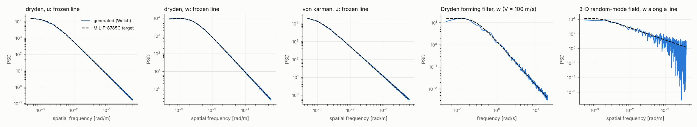
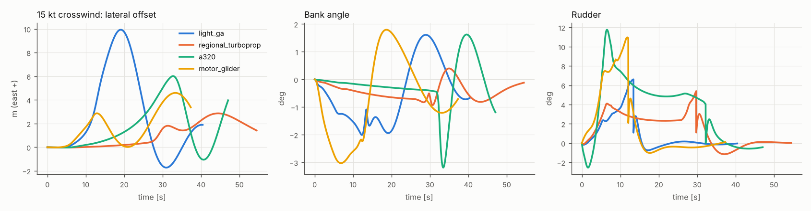
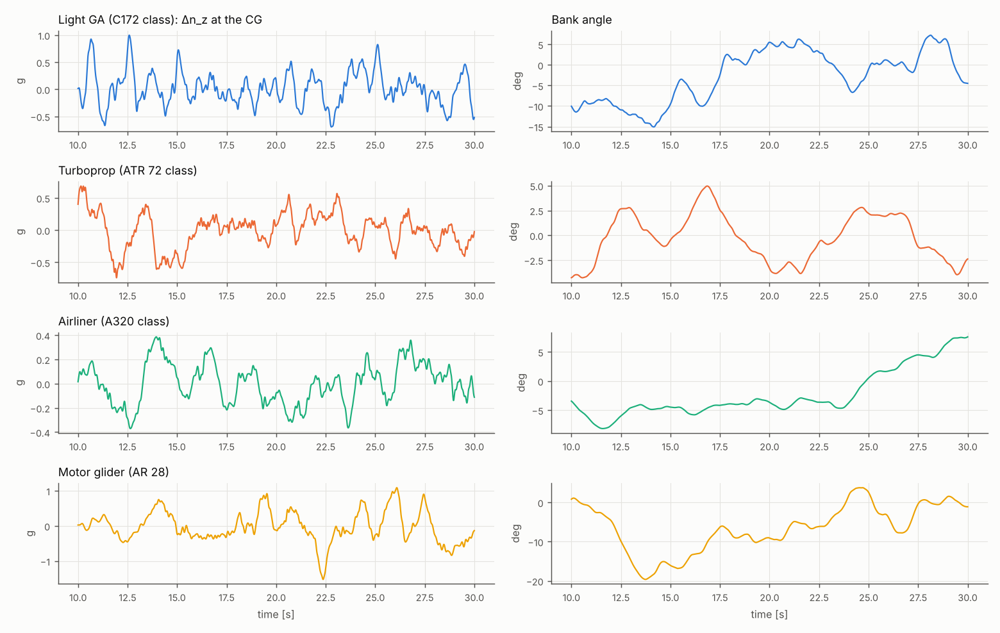
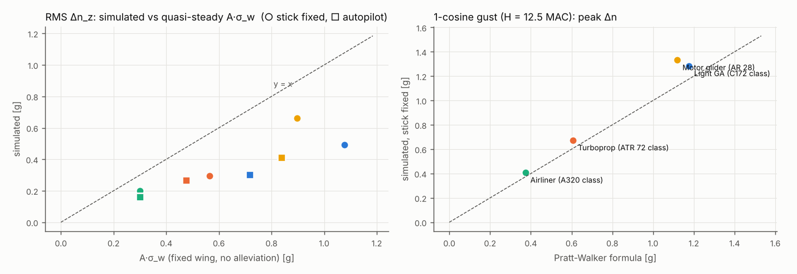

# Flight dynamics, turbulence and take-off

`pinneapple_simulation.flight` flies a rigid aircraft in six degrees of freedom. The wing and tail loads come from the
library's vortex lattice (`pinneapple_design.aero.vlm`), solved again at every step with the local air velocity at
each panel. The other parts are thrust, gravity, landing-gear contact with the runway, MIL-F-8785C / MIL-HDBK-1797
turbulence and gusts, trim, a simple pilot / autopilot, and animated 3-D scenes for the browser viewer and Blender.

```python
from pinneapple_simulation import flight

ac = flight.catalog.build("a320")                  # light_ga, regional_turboprop, a320, motor_glider
tr = flight.trim(ac, V=128.0, altitude=3000.0)     # alpha, elevator, throttle for steady level flight
d = flight.stability_derivatives(ac, tr)           # CL_alpha, Cm_q, Cl_p, Cn_beta, ... and the static margin

hist = flight.simulate_takeoff(ac)                 # brake release -> V_R -> lift-off -> 400 ft
m = flight.takeoff_metrics(ac, hist)               # ground roll, V_LOF, theta, distance to 35 ft, climb gradient
cf = flight.raymer_takeoff(ac)                     # closed-form estimate with the same aircraft model

spec = flight.turbulence_spec(3000.0, "severe")    # von Karman, MIL-F-8785C intensities and scale lengths
hist, metrics, *_ = flight.turbulence_encounter(ac, 128.0, 3000.0, spec, duration=60.0)

from pinneapple_tools.visualization.studio.web import web_viewer
web_viewer(flight.visuals.flight_scene(ac, hist), "viewer/")   # time slider, gust arrows, wing loading, HUD
```

Every number on this page was produced by the scripts in `examples/flight_dynamics/` and is stored in
`examples/flight_dynamics/results/*.json`. The tables are filled from those files by `06_tables.py`.
Where an input is an assumption, it is listed as one in `Aircraft.info["assumptions"]` and below.

## The four aircraft

| key | type | geometry | mass, engines |
|---|---|---|---|
| `light_ga` | Cessna 172-class single piston | the aero optimizer's baseline `Airframe` | 1100 kg, 120 kW (the optimizer's calibrated C172-class defaults) |
| `regional_turboprop` | ATR 72-600-class twin turboprop | planform and gear of the `turboprop_atr72` geometry-library entry; its mesh for the visuals | 23,000 kg, 2 x 2,475 shp normal take-off power (ATR brochure 2023, factsheet 2020) |
| `a320` | A320-class twin turbofan | the aero optimizer's baseline `Airliner` | 73,500 kg (the optimizer's A320-class MTOW), 2 x 27,000 lbf (CFM56-5B4 rating, CFM / EASA TCDS E.003) |
| `motor_glider` | high-aspect-ratio self-launching motor glider | parametric `Airframe` with the Stemme S10's span (23 m) and area (18.7 m², AR 28.3) | 850 kg, 84.5 kW (Stemme S10 / S10-VT) |

Masses and inertias come from a component breakdown, with the CG put at 25 % MAC (30 % for the glider). The
component masses are the wing (the Raymer general-aviation or transport equation, as the aero optimizer uses them),
the tails, engines, fuel, payload or occupants, and the fuselage and systems. Zero-lift drag is the aero optimizer's
component build-up (fuselage, fin, nacelles, wing and tail friction with form factors, miscellaneous). Induced drag
uses K from the lattice's Trefftz-plane drag.

<!-- table:aircraft -->
<!-- /table:aircraft -->

Assumptions, per aircraft, are in `results/stability.json` (`info.assumptions`). The main ones:

- Take-off CLmax is 1.6 (GA, flaps 10°), 2.1 (turboprop, flaps 15°), 2.0 (A320 class, CONF 1+F) and 1.45 (glider).
  These values set V_R and the stall margin and are not computed.
- Flaps are modelled as a rotation of the panel normals by tau·delta on the flapped strips. Tau is the thin-airfoil
  flap effectiveness × 0.85. Slats are not modelled.
- The gear positions are taken from the geometry where it has gear (ATR 72 entry). On the A320 class they are chosen
  so the nose gear carries ~7 % of the weight. On the light aircraft the mains sit at a 15° tip-back angle.
- Tyre rolling friction is 0.02.
- Propellers have efficiency 0.80 (0.75 on the glider) and a static figure of merit of 0.70.

## Models

**Rigid body.**
- Axes: earth NED, body x forward / y right / z down.
- State: position, body velocity, a unit quaternion for the attitude, and body rates. Euler angles are only an
  output, and `quat_to_euler` stays finite at θ = ±90°.
- Equations: `x' = C v`, `v' = F/m − ω × v`, `ω' = I⁻¹(M − ω × Iω)`.
- Integration: RK4 with the quaternion renormalised after each step.

**Aerodynamics (quasi-steady vortex lattice in the loop).**
- At every evaluation, the relative air velocity at each control point (flight velocity, `ω × r`, and the wind sampled
  per spanwise strip) sets the right-hand side of the lattice.
- The influence matrix depends only on the geometry, so it is LU-factorised once.
- Forces come from Kutta-Joukowski on the bound legs with the local velocity. Lift, pitching moment, pitch and roll
  damping, downwash at the tail and the dihedral effect therefore all come from one model. So does the rolling moment
  of a gust that differs from one wing to the other.
- Control surfaces rotate their panels' normals (elevator, ailerons, flaps).
- Added by build-up:
  - the fin as a lifting line, with the Helmbold lift slope at 1.55 × its aspect ratio and the rudder through tau;
  - the fuselage Munk moments in pitch and yaw (Raymer eqs. 16.25, 16.47);
  - zero-lift drag, gear and flap drag;
  - induced drag, with McCormick's ground-effect factor at the wing height.

**Engines.**
- Turbofan: Mattingly's high-bypass lapse T/T_SL = δ₀(1 − 0.49 √M).
- Propeller: T = ηP/√(V² + V₀²), so T equals the momentum-theory static thrust at rest and ηP/V in flight.

**Gear.** Each leg is a vertical spring-damper with a rolling resistance μN and a tyre side force that saturates at
the friction limit. The nose wheel steers. Springs and dampers are sized for a 0.25 m static compression and a
damping ratio of 0.6.

**Trim and derivatives.**
- `trim` zeroes u̇, ẇ and q̇ for given speed, altitude and flight-path angle.
- `stability_derivatives` takes central differences of the full model.
- `modes` gives the eigenvalues of the 12-state linearisation.

**Pilot and autopilot.**
- The pitch, roll and yaw loops are designed per aircraft from its own Cm_δe, Cl_δa, Cn_δr and inertias, for a
  target natural frequency and damping, and scheduled with the dynamic pressure.
- Outer loops: altitude through pitch attitude, heading through bank, airspeed through the throttle, and a washed-out
  yaw damper.
- Take-off schedule (an assumed technique, not a certified one):
  - full throttle and the take-off flap;
  - nose wheel and rudder hold the centreline, ailerons hold the wings level;
  - at V_R the pitch attitude goes up at 3°/s to 12° (transports) or at 6°/s to 11° (light aircraft);
  - V_R is 1.05 V_s (transports) or 1.10 V_s (light aircraft), with V_s the take-off-flap stall speed;
  - after lift-off the pitch attitude is trimmed to fly 1.25 V_s (1.30 V_s for light aircraft), and bank holds the
    track along the runway.

**Turbulence** (`flight.turbulence`, MIL-F-8785C §3.7 and MIL-HDBK-1797 §4.9):

- Intensities and scale lengths:
  - Low altitude (h < 1000 ft): σ_w = 0.1 W₂₀ with W₂₀ = 15 / 30 / 45 kt. σ_u = σ_v = σ_w / (0.177 + 0.000823 h)^0.4.
    L_w = h and L_u = L_v = h / (0.177 + 0.000823 h)^1.2.
  - Medium and high altitude (h > 2000 ft): isotropic. σ comes from the exceedance-probability chart: light 1e-2,
    moderate 1e-3, severe 1e-5. L is 1750 ft (Dryden) or 2500 ft (von Kármán).
  - Between 1000 and 2000 ft, values are interpolated linearly.
- Spectra:
  - Dryden: Φ_u = σ²(2L/π)/(1 + (LΩ)²), Φ_w = σ²(L/π)(1 + 3(LΩ)²)/(1 + (LΩ)²)².
  - von Kármán: the same with exponents 5/6 and 11/6 and the 1.339 factor.
- Generators:
  - `FrozenLine`: spectral synthesis along the path, with exact amplitudes and random phases.
  - `DrydenFilter`: the forming filters with white noise, discretised exactly (Van Loan).
  - `FrozenField3D`: isotropic, divergence-free 3-D von Kármán turbulence from random Fourier modes (Kraichnan 1970).
    Its energy spectrum E(k) projects exactly onto the MIL 1-D spectra (checked by quadrature).
  - `DiscreteGust`: the 1-cosine gust, as the MIL ramp or the full shape.
  - `ShearWind`: the logarithmic wind profile.
- The high-altitude intensity table is the MIL-F-8785C Figure 7 table as used by common implementations of the
  specification. It is reproduced in `HIGH_ALTITUDE_SIGMA_FT_S`.

<!-- table:derivatives -->
<!-- /table:derivatives -->

The oscillatory modes are listed fastest first: short period, Dutch roll, phugoid.

## Verification

**Turbulence against the target spectra.** Each generator, component and spectral form is checked. The PSD ratio is
the band-averaged Welch PSD divided by the target, in eight log bands between 4/L and the resolution.

The frozen line has exact amplitudes, so its variance is the band-limited integral of the target spectrum. The
forming filter is a stochastic process, so 200,000 samples leave a few per cent of scatter.

The 3-D field is one realisation of 96 × 32 random modes. Its spectrum along a line is spiky, and the scatter of its
band ratios (0.66 to 1.34 in the table) is the sampling noise of one realisation, not a bias. Its isotropic energy
spectrum matches the MIL forms to 1e-3 by quadrature (`tests/test_flight_turbulence.py`).



<!-- table:psd -->
<!-- /table:psd -->

**Trim.** Each aircraft is trimmed at its cruise point and flown stick-fixed for 10 s. The 1e-9 m/s airspeed change
is the regularisation constant in the airspeed norm, not a drift.

<!-- table:trim -->
<!-- /table:trim -->

**Energy and angular momentum.** The test case is the A320-class body, spinning and translating under gravity alone
for 20 s. Kinetic plus potential energy and the angular momentum in NED must be conserved. The error falls with the
RK4 order as the step is halved.

<!-- table:conservation -->
<!-- /table:conservation -->

**Lattice in the loop vs the steady lattice.** The lift of the in-the-loop model (Kutta-Joukowski with the inclined
free stream) is compared with the linearised steady solution at α = 0 and 4°. The two agree to O(α²).

<!-- table:lattice -->
<!-- /table:lattice -->

**Take-off closed form.** Raymer's take-off distance (Aircraft Design: A Conceptual Approach, §17.8) is evaluated with
the same thrust, lift, drag and ground-effect model as the simulation. The table below shows it twice: once with
Raymer's V_LOF = 1.1 V_s and his 1 s / 3 s rotation, and once with the simulated V_LOF and rotation time.

## Take-off

Runs: ISA, sea level, no wind, from rest on the gear at full throttle, stopped at 400 ft. "To 35 ft" is the distance
at which the CG has climbed 35 ft above its rest height.


<!-- table:takeoff -->
<!-- /table:takeoff -->

**A320 class against published values.** The certified take-off field length is the longer of two distances: the
one-engine-inoperative distance, and 1.15 × the all-engines distance to 35 ft. It is published for the 78 t MTOW. The
simulation runs all engines, with no margin, at 73.5 t. The two numbers are of the same order but are not the same
quantity.

<!-- table:a320 -->
<!-- /table:a320 -->

**Crosswind.** The wind is 15 kt at 20 ft from the right, with the MIL-F-8785C logarithmic profile. The pilot keeps
the centreline with the nose wheel and the rudder and the wings level with the ailerons. After lift-off it holds the
track, so the aircraft crabs into the wind.



<!-- table:crosswind -->
<!-- /table:crosswind -->

**Gust during rotation.** A 1-cosine down-gust of 4 m/s over 60 m is placed where the nominal run reached V_R.

<!-- table:gust -->
<!-- /table:gust -->

## Turbulence encounters

The turbulence is the same for all four aircraft: von Kármán, MIL-F-8785C severe (exceedance probability 1e-5) at
3000 m, σ = 7.05 m/s, L = 762 m. It is a frozen 3-D field, so the two wings meet different gusts.

Each aircraft flies at its own cruise speed (55 / 120 / 128 / 30 m/s) for 120 s. Each case is run stick-fixed and
with the autopilot (altitude, heading and speed hold), in three realisations of the field. The first 5 s are
discarded.

Cabin accelerations are the specific force at the passenger stations: `a_cg + ω̇ × r + ω × (ω × r)`. Load factors
are in body axes, so steady level flight gives n_z = cos θ.

<!-- table:turbulence -->
<!-- /table:turbulence -->




**Wing loading and lift-curve slope.** A rigid wing held fixed in a vertical gust w would see
Δn = A·w with A = ρ V CL_α / (2 W/S). A·σ_w is therefore an upper bound for the RMS increment: plunge and pitch
relieve it. The Pratt-Walker formula adds the alleviation factor K_g = 0.88 μ / (5.3 + μ), with the mass ratio
μ = 2(W/S) / (ρ c̄ CL_α g), for a 1-cosine gust of half-length 12.5 c̄. Here U_de = 25 ft/s EAS, the same for every
aircraft.

The simulation is quasi-steady, without Küssner / Wagner lift lag. Its discrete-gust peak should therefore lie
between Pratt and the unalleviated value.



<!-- table:pratt -->
<!-- /table:pratt -->

**The same gust for all four.** One physical gust: a vertical 1-cosine up-gust of 7.62 m/s over 100 m (H = 50 m)
at 3000 m, stick fixed, each aircraft at its cruise speed (`07_same_gust.py`). The slow, lightly loaded aircraft
meet it for longer, so they have time to plunge and pitch into it. Pratt's K_g was derived for H = 12.5 MAC and is
shown only for reference.

<!-- table:same_gust -->
<!-- /table:same_gust -->

**What the spanwise variation does.** The same aircraft are run stick-fixed in a frozen line, where the gust is
uniform across the span, at the same intensity. Without spanwise variation, the only rolling input is sideslip
through the dihedral effect.

<!-- table:spanwise -->
<!-- /table:spanwise -->

**Intensity.** Light, moderate and severe turbulence, autopilot on, one realisation for light and moderate.

<!-- table:intensity -->
<!-- /table:intensity -->

## 3-D visualisation

`flight.visuals.flight_scene(ac, hist, wind=...)` builds a studio `Scene` with an `Animation`. It contains:

- the aircraft mesh (the parametric airframe, or the geometry-library mesh for the ATR class) moved by the recorded
  attitude and position;
- the runway with its markings;
- the trajectory trail;
- the gust field as arrows on a heading-aligned grid around the aircraft, coloured by the vertical gust;
- the lattice loading ΔCp on a sheet just above the wing and tail skins;
- a HUD with airspeed, height, n_z, pitch and bank.

`web_viewer` writes the browser viewer, which has play / pause, a time slider, playback speed, a follow camera and a
vectors toggle. `blender.render_animation` renders Cycles frames with the HUD burnt in and encodes MP4 / GIF.

The viewers are written by `03_takeoff.py` and `04_turbulence_encounters.py` into `examples/flight_dynamics/_out/`
(not committed). Open one with `python -m http.server -d examples/flight_dynamics/_out/a320_takeoff/viewer`.

<!-- screenshots -->

Clips are rendered by `05_render_clips.py` from the saved runs. They are 720 × 405, 12 Cycles samples and 96 frames
at 12 fps, kept small enough to commit, in `docs/assets/flight_dynamics/clips/`. Raise `--size`, `--samples` and
`--frames` (with `--keep-in-out`) for full-resolution renders.

<!-- clips -->

## Reproduce

```bash
python examples/flight_dynamics/01_verification.py          # PSD, trim, conservation, lattice checks (~2 min)
python examples/flight_dynamics/02_trim_and_stability.py    # trim, derivatives, modes, mass properties (<1 min)
python examples/flight_dynamics/03_takeoff.py               # take-offs, crosswind, gust, viewers (~10 min)
python examples/flight_dynamics/04_turbulence_encounters.py # encounters, Pratt (~2 h on 4 cores)
python examples/flight_dynamics/05_render_clips.py          # Blender clips (needs bpy; ~1 h)
python examples/flight_dynamics/06_tables.py                # the tables on this page
pytest tests/test_flight_turbulence.py tests/test_flight_dynamics.py tests/test_studio_animation.py
```

## Limits

- **Quasi-steady aerodynamics.**
  - Lift follows the angle of attack instantly: there is no Wagner or Küssner lift build-up and no downwash lag
    (Cm_α̇).
  - Short gusts are therefore felt fully. This is why the discrete-gust peaks exceed Pratt's.
- **Linear lattice.**
  - The lattice has no stall and no section-drag polar. Only the stall margin (maximum CL reached against the assumed
    take-off CLmax) is reported.
  - Thickness, compressibility and viscous effects on lift are absent. The aero optimizer's Prandtl-Glauert stretch
    is not used here, because all runs are at M ≤ 0.43.
- **No aeroelasticity.** The wing is rigid. On the high-aspect-ratio glider and the airliner, wing bending would
  change both the gust loads and the cabin accelerations.
- **Ground effect** acts on the induced drag only (McCormick factor). The lift increase near the ground is not
  modelled.
- **Turbulence fields.**
  - The 3-D field is isotropic, with one scale length (L_w). At low altitude it keeps the MIL intensities but not
    their different scale lengths.
  - The frozen-field (Taylor) hypothesis is used throughout.
- **Propeller and engine effects.** Slipstream, torque, P-factor and gyroscopic moments are not modelled, and the
  engines respond instantly to the throttle.
- **Aircraft data.** The aircraft are "class" models, not the real types. Planforms, masses, inertias, take-off
  CLmax, gear stiffness and the pilot technique are estimates or assumptions (listed above and in
  `Aircraft.info`). Only the published figures quoted with their source are data.
- **One-engine-out take-off and braking are not simulated.** The certified field length therefore cannot be
  reproduced; only the all-engines distance is compared.
