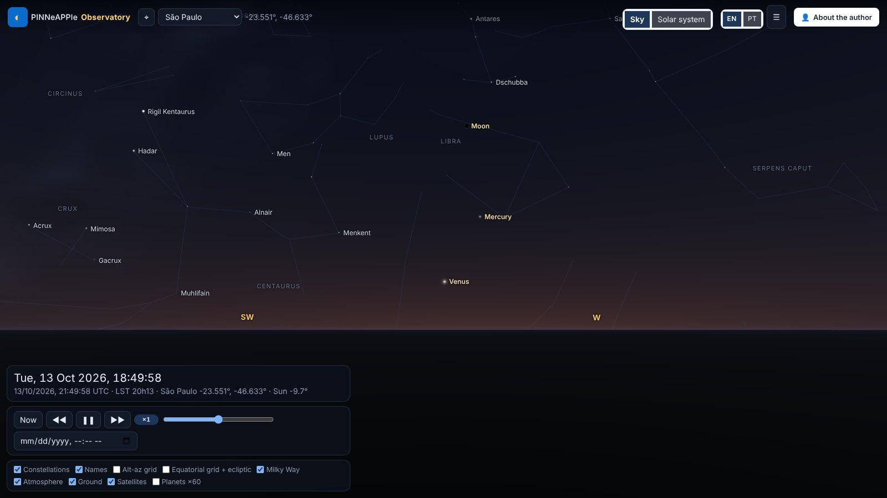
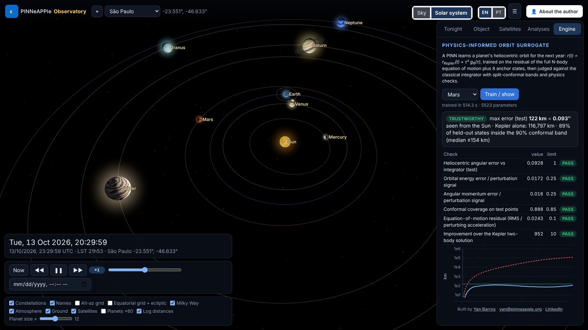
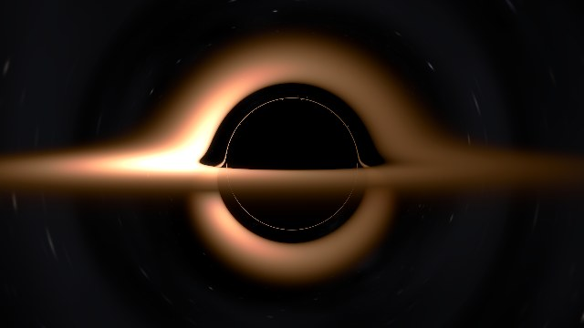

# The PINNeAPPle Observatory

A 3-D web app that shows the sky and the solar system as they are now from the visitor's location, with satellites,
astrophysics analyses and a physics-informed orbit surrogate shown with its trust checks.



## Run it

```bash
pip install -e ".[sky]" -r apps/observatory/requirements.txt
cd apps/observatory && uvicorn observatory.api:app --port 8094
```

Open `http://localhost:8094`, press ⌖ (or pick a city). Drag to look around, scroll or pinch to zoom, click an object.
*Solar system* flies out from your position to the planets; *Sky* flies back. URL parameters make views reproducible:
`?lat=-23.55&lon=-46.63&t=2026-10-13T22:05:00Z&az=250&alt=16&fov=72` (`view=system`, `tab=engine`, `panel=0`).

## What is computed where

The server (`apps/observatory/observatory/api.py`) calls `pinneapple_physics.astro` for every position, event and
analysis and returns samples a few minutes apart; the browser interpolates them, rotates the J2000 star catalogue with
the server's precession-nutation matrix and the sidereal time, and draws (three.js r169, vendored with the library).
Refraction and extinction of the stars are applied in the vertex shader with the same formulas as the library.

## Checking it

`pytest tests/test_astro_accuracy.py tests/test_observatory.py` runs the accuracy checks
([table](../core_concepts/astro.md#accuracy)) and every API endpoint offline (a local TLE file stands in for CelesTrak).



## PINNs, neural networks and ML in the app

Every model carries a trust card: its verdict, its checks against an independent reference, and a short "how this was
computed, how much to trust it". The numbers are in [the astronomy page](../core_concepts/astro.md#pinns-and-machine-learning-in-the-observatory).

- **Satellites → Orbit decay**: a PINN integrates the drag decay of the ISS-like orbit through the NRLMSIS 2.0
  thermosphere for the solar flux and geomagnetic activity you set, with a Monte-Carlo envelope of the inputs; it is
  compared with a Runge-Kutta integration and with SGP4's own drag model.
- **Analyses → Asteroids and close approaches**: Apophis, Phaethon, Ceres and 67P from JPL SBDB elements, propagated
  in the field of the Sun, planets and Moon; the Apophis flyby of 13 April 2029 is reproduced within JPL's 3σ range.
  A PINN can be trained for the selected body (Kepler orbit plus a network for the planetary perturbations, about a
  minute) and is checked against the integrator. A learned propagator (one network for many near-Earth asteroids)
  is shown with its errors on unseen bodies and is rejected by its own gate.
- **Analyses → Space weather and aurora**: Kp now and 3 h / 24 h ahead with calibrated 80 % intervals, and the chance
  of seeing the aurora overhead or low on the horizon at your geomagnetic latitude.
- **Analyses → Observing conditions**: P(clear sky), cloud quantiles, transparency and a seeing proxy from the
  Open-Meteo ensemble (marked not verified until it is calibrated against observations).
- **Analyses → Stellar ML**: the HR diagram clustered without labels, and the luminosity / spectral classes predicted
  from colour and absolute magnitude, cross-validated against the catalogue.
- **Analyses → Black hole**: a thin accretion disc around a Schwarzschild black hole, traced along exact null
  geodesics and lensed in front of the part of the sky you are looking at (Doppler beaming on or off). The far side
  of the disc appears above and below the shadow, with the photon ring inside.


