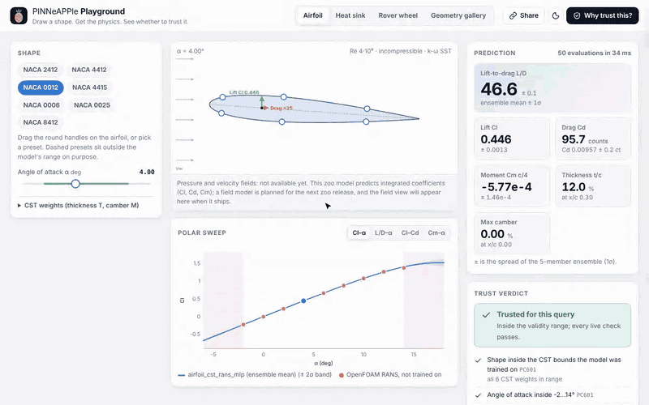

# Playground: physics surrogates in the browser

The Playground is a static web page. You draw an airfoil, size a heat sink or drive a lunar-rover wheel, and a
PINNeAPPle zoo model answers immediately. Next to each answer the page shows the physics checks and the model's
trust verdict. Everything runs in the browser: nothing is installed and nothing is sent to a server. The URL holds
the whole state, so a link opens exactly what you were looking at.



| Mode | Model (zoo) | What you change | What you get |
|---|---|---|---|
| Airfoil | `airfoil_cst_rans_mlp` | Drag the CST handles on the airfoil, pick a NACA preset, set the angle of attack | Cl, Cd, Cm and L/D with the spread of the 5-member ensemble; the polar sweep, with the OpenFOAM runs the model never saw and an XFOIL polar overlaid for the NACA presets |
| Heat sink | `heatsink_forced_mlp` | Fin count, height and thickness, air speed (plus base, material, power) | Thermal resistance with its split-conformal 95 % bound, base temperature, pressure drop, and R and ΔP against air speed |
| Rover wheel | `rover_contact_grc1_viper` | Slip and sinkage of the VIPER wheel on GRC-1 | Drawbar pull, normal load and torque, with held-out points of the analytic Wong–Reece model near the current sinkage |
| Geometry gallery | `pp.geometries` | Pick one of the 17 geometries | A 3-D view of the light glTF file, its dimensions and sources, and the code that regenerates it |

## The trust verdict

The checks are the library's per-query checks, `pp.zoo.query_checks` (see
[the zoo guide](model_zoo.md#7-check-each-query-export-to-onnx-run-in-a-browser)). They are evaluated inside the
model's ONNX graph on every change. Their rule IDs are the ones [`pinneapple check`](physics_checks_in_ci.md) uses:

- **PC601, out-of-range query.** Is every input inside the model card's validity range? This includes the derived
  limits: the fin gap and the source fraction of the heat sink. It is the same rule as `ZooModel.in_range`, tested
  on thousands of inputs. A query that fails it is labelled an extrapolation, in red.
- **PC403 / PC402, non-finite or unphysical output.** For example, a negative drag, or airfoil surfaces that cross.
- **PC602, sparse training region.** The ensemble spread is compared with its 99th percentile on the held-out shapes.
- **PC302, model residual.** The zoo gate's physics checks, evaluated at the query:
  - the lift slope against thin-airfoil theory, and Cl rising with α;
  - more airflow or a more conductive material lowering the resistance;
  - the Mohr–Coulomb traction limit, My ≥ R·Fx, and the monotonic trends of the wheel.

The **Why trust this?** panel shows the full model card:

- the validity range;
- the held-out metrics against the independent reference, next to the zoo's acceptance limits;
- the physics checks of the stored trust report;
- data provenance and known limitations;
- the SHA-256 and the measured parity of the ONNX file the page runs.

The airfoil design constraints are shown separately: t/c ≥ 11 % and |Cm| ≤ 0.10, the defaults of
`pinneapple_design.aero.aircraft.Requirements`. They say whether a design is acceptable, not whether the model can
be trusted.

Note that the NACA 4412 and 4415 presets sit just outside the model's CST box: M1 0.142 > 0.14 and M2 0.123 > 0.12.
`pp.zoo` raises an `OutOfRangeWarning` for them, and the page marks them red. Their OpenFOAM reference runs, which
the model never saw, are overlaid on the polar, so you can judge the extrapolation yourself.

There is no pressure or velocity field yet. The zoo's airfoil model predicts integrated coefficients only, and the
field model (MeshGraphNet) is waiting for its training fields to be regenerated and published. The page says so in
place of a field view.

## How it is built: the library does the work, the app draws

The app (`apps/playground/site/`) is UI code only. Everything it computes comes from library artefacts.

**The zoo models.** `pp.zoo.export_web` writes each model as one ONNX graph (`pinneapple_hub.zoo.export`):

- input `x`, for the predictions, and input `query`, for the query checks;
- pre- and post-processing included: CST encoding, log features, normalisation, ensemble mean and spread, L/D per
  member, and the conformal bound;
- a JSON file next to it with the model card, the check spec (limits, templates, verdict texts) and the reference
  points to overlay.

**The airfoil geometry.** `pinneapple_design.aero.geometry_onnx` exports the CST geometry as two float64 graphs.
They reproduce `pinneapple_design.aero.geometry` to round-off:

- the outline, thickness and camber, the two validity quantities, and the positions of the drag handles;
- handle heights back to CST weights, via `geometry.shape_from_handles`.

**The gallery.** `pp.geometries.export_web` writes an index and thumbnails.

**The runtime.** `pinneapple_hub/zoo/web/onnx.js` and `zoo.js` ship with the package. They contain:

- a ~400-line ONNX interpreter that reads the protobuf directly;
- `loadModel`, `loadAirfoilGeometry`, and `evaluate`, which turns the check values into statuses and a verdict
  exactly like `pinneapple_hub.zoo.checks.evaluate`.

`engine=ort` in the URL hash runs the same files in onnxruntime-web 1.22.0, loaded from jsDelivr. It is about 10 MB
of WebAssembly, so it is opt-in. Pyodide is not used: there is no Python left to run in the browser.

Sizes: the airfoil mode loads 0.67 MB before compression. A 50-point polar with its checks takes 10–60 ms.

What is tested, in CI (`.github/workflows/playground.yml`):

- **Library, Python** (`tests/test_zoo_web.py`):
  - The ONNX export of each model matches PyTorch to 1e-5 on every held-out and independent-reference input.
    Measured: 5.1e-7 airfoil, 1.6e-6 heat sink, 5.7e-7 rover.
  - The query checks never change status away from a limit.
  - Range checks fail exactly where `ZooModel.in_range` is False.
  - Held-out inputs are trusted.
  - The geometry graphs match NumPy to 1e-10.
  - The committed bundle in `data/web` is current.
- **Library, JavaScript** (`tests/js/zoo_web.test.mjs`): the interpreter, `evaluate` (statuses and detail texts)
  and the geometry graphs, compared with Python fixtures.
- **App** (`tests/test_playground.py` and the Playwright test in `apps/playground/tests/e2e`):
  - Every mode loads.
  - The numbers and verdicts on the page match Python for fixed inputs, in and out of range.
  - Dragging changes the answer and the URL, and a shared link reproduces the state.
  - The trust panel shows the evidence.
  - The page works offline, and the mobile layout has no horizontal scroll.
  - onnxruntime-web gives the same numbers as the built-in interpreter.
  - The app holds no model, geometry or check code.

## Run it locally

```bash
python apps/playground/build.py --serve          # http://localhost:8765/
```

The build uses only the standard library. It assembles the UI from three sources:

- the library's runtime and its browser bundles (`data/web/zoo`, `data/web/geometries`);
- three.js, vendored in `pinneapple_tools`;
- the light glTF files from `data/geometries/`.

The output uses relative paths only, so it works under any URL prefix.

When a zoo model or the geometry library changes, regenerate the bundles with the library:

```bash
python -m pinneapple_hub.zoo.web data/web/zoo                      # needs torch, onnx, onnxruntime
python -m pinneapple_design.geometry_library.web data/web/geometries
cd apps/playground && npm ci && npm test                           # JS runtime tests + Playwright smoke test
```

## Deploying

The page is static, so there are two options, both prepared and neither switched on:

- **Docker + Caddy, next to the other apps.** `apps/playground/Dockerfile` builds the site and serves it with Caddy
  on port 8095. `apps/deploy` has the `playground` service and the `PLG_DOMAIN` site block.
- **GitHub Pages, under the docs site.** Set the repository variable `PLAYGROUND_PAGES` to `true`. The docs workflow
  then publishes the build at `https://pinneapple-labs.github.io/PINNeAPPle/playground/`.
