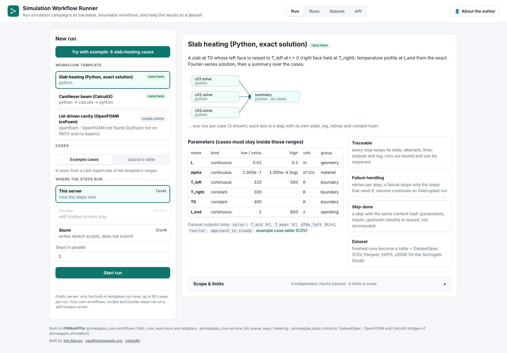
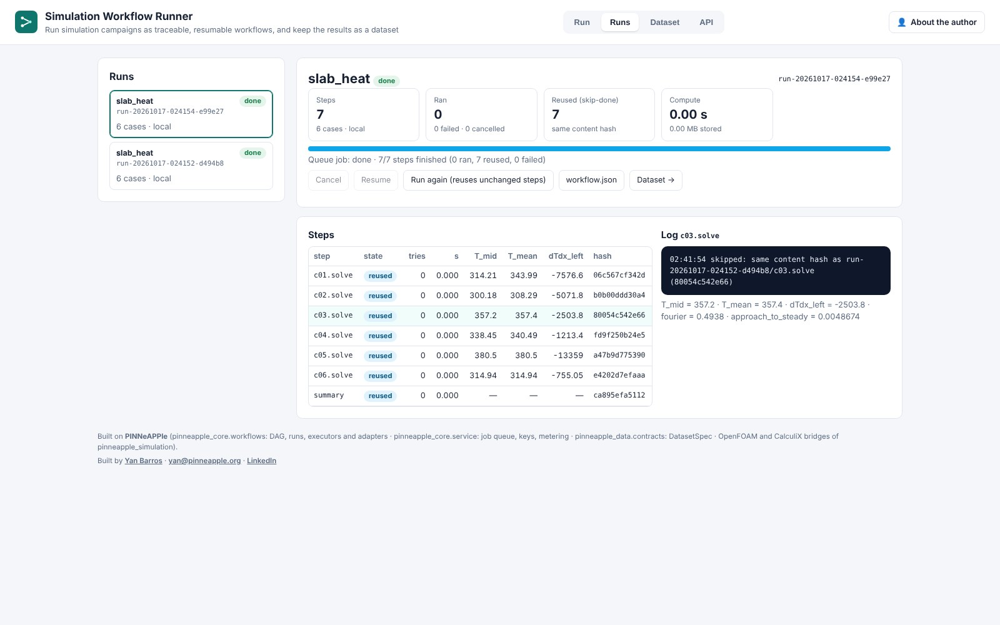
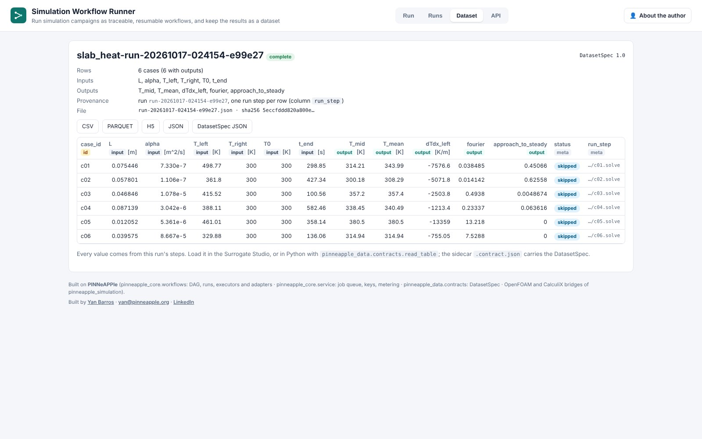

# Simulation Workflow Runner: campaigns as traceable, resumable workflows

The Workflow Runner (day 27, [runner.pinneapple.org](https://runner.pinneapple.org)) runs a simulation campaign as
a DAG of steps per case. It records what happened to every step, picks up where an interrupted campaign stopped,
reuses steps whose inputs did not change, and returns the finished runs as a training dataset. It orchestrates
the tools you already have (OpenFOAM, CalculiX, Python, Docker, Slurm); it does not replace them.



## From cases to a dataset

1. **Cases.** A table with one row per case, as CSV, Parquet, HDF5 or JSON. A Campaign Planner export works as it is,
   including its `.contract.json` sidecar. On the public server the columns must be the template's parameters, inside
   its ranges.
2. **Template.** The steps run for each case and their dependencies:
   - *slab heating*: the exact solution of transient conduction, in Python;
   - *cantilever beam*: a CalculiX deck from `calculix.study.FEModel`, then `ccx`, then a comparison with beam theory;
   - *lid-driven cavity*: OpenFOAM's icoFoam on the tutorial case with edited dictionaries.
3. **Executor.** Where the commands run: this server, Docker (self-hosted), or Slurm. On the public server, the Slurm
   executor only writes the sbatch scripts.
4. **Run.** Each step has a state, attempts, wall time, outputs and a log. A failed step cancels only the steps that
   need it. **Resume** continues an interrupted or failed run. **Run again** starts a new run and reuses every step whose
   content hash is unchanged.
5. **Dataset.** The parameters and outputs of every case, as CSV, Parquet, HDF5 or JSON, with a `DatasetSpec`. The spec
   records columns with units and roles, the file's SHA-256, and the run step behind each row.





## The same engine in Python

```python
from pinneapple_core.workflows import Step, Workflow, WorkflowRunner, TEMPLATES, dataset_from_run

runner = WorkflowRunner("work/runner")
t = TEMPLATES["slab_heat"]
cases = t.example_cases(20)                       # or read_cases("campaign.parquet")
run = runner.run(t.workflow(cases, max_parallel=4))
runner.run(run_id=run["id"])                      # resume (no-op when everything finished)
spec, path = dataset_from_run(runner, run["id"], cases, output_step="solve", path="slab.parquet")

wf = Workflow("beam", [
    Step("mesh", "command", {"argv": ["gmsh", "-3", "beam.geo", "-o", "beam.inp"]}, inputs=["beam.geo"]),
    Step("solve", "calculix", {"inp_from": "mesh", "job": "beam"}, needs=["mesh"], retries=1,
         executor="slurm", executor_options={"partition": "cpu", "ntasks": 8, "dry_run": True}),
])
```

New step kinds and executors plug in with `register_adapter` and `register_executor` (see
[the app README](https://github.com/PINNeAPPle-Labs/PINNeAPPle/tree/main/apps/simulation_runner#plugging-in-executors-and-step-kinds)).
This is how the Engineering GUI Agent adds GUI-driven steps.

## What was checked

- **Skip-done, resume, retries.** Tests in `tests/pinneapple_core/test_workflows.py` cover:
  - a rerun with unchanged content runs nothing;
  - changing one step's parameter reruns it and everything downstream;
  - a crash mid-run is resumed without redoing finished steps;
  - retries recover from transient failures;
  - cancel kills a running command.
- **Slurm.** The generated script carries the partition, tasks, memory, account, time limit, modules and the `srun`
  line (dry run, tested).
- **CalculiX template.** With CalculiX 2.21, the C3D8I tip deflection is 0.993 to 1.007 of Euler-Bernoulli over the
  six example beams. The test asserts within 2 % whenever `ccx` is installed.

## Limits

- **Public server: built-in templates only**, with numeric case values checked against the template's ranges.
  Self-hosting (`RUNNER_SELF_HOSTED=1`) enables custom commands, scripts and Docker steps. Only do that behind your
  own login.
- **Solvers.** The public image has no OpenFOAM or CalculiX. Those templates show "needs solver" there instead of
  pretending.
- **Skip-done hashes only what a step declares.** Undeclared input files and solver versions are not seen.
