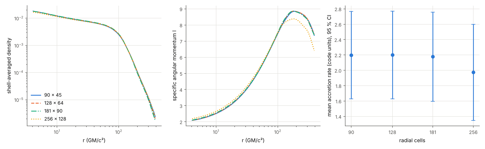
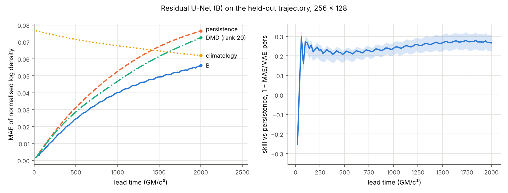

# Black-hole weather: forecasting the gas around a black hole, and knowing for how long to trust it

This is a reproduction and extension of **Duarte, Nemmen & Navarro (2022)**, *Black hole weather forecasting with deep learning: a pilot study*:
- MNRAS 512, 5848; [arXiv:2102.06242](https://arxiv.org/abs/2102.06242);
- original code (MIT): [black-hole-group/DL_BH_fluids](https://github.com/black-hole-group/DL_BH_fluids).

The work is tracked in issue [#399](https://github.com/PINNeAPPle-Labs/PINNeAPPle/issues/399). All credit for the idea and the architecture goes to the original authors. Mistakes in this port are ours.


*General-relativistic ray tracing of the simulated flow (left) and of the U-Net forecast (right).*
- Light bends around the hole, which gives the shadow, the photon ring, the lensed far side of the flow and the lensed stars.
- The gas moving towards us is Doppler-boosted.
- The bar compares the forecast error with doing nothing (persistence).


*The same forecast in the PINNeAPPle-Twin3D viewer: a 3/4 cutaway of the axisymmetric flow, with the forecast-error and mass-check sensors.*

## What was done

| step | how | where |
|---|---|---|
| simulations | Four 2.5-D viscous hydro runs of a torus accreting onto a Schwarzschild hole: Paczyński-Wiita potential, α-viscosity, 128 × 64 cells, r = 4-400 GM/c², 10⁴ GM/c³ each, frames every 10 GM/c³. The paper's PLUTO data are on Figshare, which this environment cannot reach, so the flows were regenerated with the library's own solver. | `simulate.py`, `pinneapple_physics.blackhole.hydro` |
| solver checks | Mass and angular momentum conserved to 10⁻¹⁶; exact Bondi accretion steady within 0.5 % (accretion rate); the inviscid torus holds its equilibrium. | `tests/test_blackhole_weather.py` |
| forecaster | The paper's U-Net, ported layer for layer (5×5 convolutions, LeakyReLU 0.3, 5 frames in and 5 out, log-density normalisation, crop, the paper's loss). Filters 16 instead of 32 to fit a 4-core CPU. | `train_forecaster.py`, `pinneapple_physics.blackhole.forecast` |
| PINNeAPPle additions | A **residual** variant that predicts the change from the last frame; lead-time scores against persistence and the time-mean flow; a **tendency correlation** (forecast change against true change); a **mass check** that needs no truth, plus a projection onto that budget; a 3D twin and a GR-ray-traced view. | `evaluate.py` |

Runs are named like the paper's: `PL{a}{SS|ST}{α}`.
- Training uses `PL0SS0.1` with the paper's one-simulation split in time (70 / 10 / 20).
- `PL0SS0.3` (α = 0.3, never seen) is the out-of-distribution test, as the paper withholds PL0SS3.

## Results

Frames are 20 GM/c³ apart, so one 5-frame prediction covers 100 GM/c³. There are 8 rollouts of 12 blocks (1200 GM/c³) from different start times in the test segment. The error is the MAE of the normalised log density.

| model | test | error at +100 M | error at +1200 M | persistence at +1200 M | beats persistence up to | tendency corr. (blocks 2-12) | mass check first fires |
|---|---|---|---|---|---|---|---|
| U-Net as in the paper | PL0SS0.1, last 20 % | 0.0059 | 0.038 | 0.0137 | never | −0.50 | +20 M (every rollout) |
| **residual U-Net** | PL0SS0.1, last 20 % | **0.0005** | **0.0076** | 0.0137 | **≥ 1200 M** (whole rollout) | **0.61** | +100 M |
| U-Net as in the paper | PL0SS0.3 (unseen α) | 0.0072 | 0.025 | 0.0193 | never | −0.39 | +20 M |
| **residual U-Net** | PL0SS0.3 (unseen α) | **0.0011** | **0.0153** | 0.0193 | **≥ 1200 M** | 0.36 | none / +1200 M |

What this says, without spin:

- **The faithful port does not beat persistence here.** Our frames are 20 GM/c³ apart, where the flow changes far less from frame to frame than the network's error. Its predicted changes are even anti-correlated with the true ones. The paper used frames 198 GM/c³ apart, from PLUTO runs at about twice our resolution, so this is not a contradiction of the paper. It does show that the absolute-frame formulation needs large frame steps.
- **The mass check catches the faithful port at the first frame.** The window loses or gains 4-6 % of its gas per frame in the forecast, against 0.36 % in the simulation. After 1200 GM/c³ it holds half the gas it should. This is the "artificial mass injection" that the original authors identify as the source of drift, and here it is flagged with no ground truth.
- **Predicting the change fixes most of it.** The residual U-Net beats persistence at every lead of the 1200 GM/c³ rollout: 45 % lower error at the end in distribution and 21 % lower out of distribution. Its changes correlate with the true ones (0.61; 0.36 out of distribution). The test segment limits the rollout to 1200 GM/c³, so the true horizon is at least that.
- **Out of distribution, skill drops but survives.** With α = 0.3 the flow evolves about three times faster. Error and tendency correlation degrade, which is the cue the trust layer should act on.
- Projecting onto the training mass budget barely changes the error: mass errors are small next to the shape errors. It stays as a guard-rail.


Per-model summaries (scores by lead, horizons, mass checks) are in `results/`.

## Zoo version: resolution study, 256 × 128 data and a retrained forecaster

The model zoo turned the first version down for three reasons: no convergence study of the reference, training data not committed, and a faithful port that does not beat persistence. This section answers each one. All the logic is in the library (`pinneapple_physics.blackhole`: `runs`, `convergence`, `dataset`, `forecast`, `skill`, `figures`); the scripts here only call it.

### 1. Resolution study of the reference

Four grids in a constant ratio √2 (90 × 45, 128 × 64, 181 × 90, 256 × 128), three seeds each. The physics is the same on every grid, and so is the initial perturbation: `RIAFConfig(perturbation_kind="modes")` samples one continuous seeded field on any grid. The statistics are time averages over t = 2000-10000 GM/c³. The 95 % intervals combine batch means within a run and the spread over seeds. Profiles and fields are compared on the coarsest grid after a conservative remap. `convergence.py` writes `results/convergence.json`.

| quantity | 90 × 45 | 128 × 64 | 181 × 90 | 256 × 128 | verdict |
|---|---|---|---|---|---|
| mean accretion rate (code units) | 2.20 ± 0.57 | 2.20 ± 0.57 | 2.18 ± 0.58 | 1.97 ± 0.63 | within the band |
| detrended ṁ fluctuation (rms) | 0.0031 | 0.0031 | 0.0033 | 0.0043 ± 0.0010 | within the band |
| mass in the window (10⁴) | 2.44 | 2.58 | 2.65 | 2.58 | within the band |
| inner density slope (r = 10-60) | −0.419 | −0.412 | −0.408 | −0.384 ± 0.031 | within the band |
| persistence error at +100 M | 0.0030 | 0.0031 | 0.0034 | 0.0047 ± 0.0011 | within the band, rising |
| l / l_Kepler at r = 10 | 0.634 | 0.639 | 0.646 | 0.671 ± 0.004 | **not converged** |
| l / l_Kepler at r = 30 | 0.670 | 0.674 | 0.678 | 0.698 ± 0.005 | **not converged** |

Relative L1 change of the time-mean profiles between consecutive grids:

| profile | 90 → 128 | 128 → 181 | 181 → 256 |
|---|---|---|---|
| shell density | 1.6 % | 0.8 % | 6.3 % |
| specific angular momentum | 0.5 % | 0.5 % | 4.2 % |
| angular-momentum flux | 2.5 % | 1.5 % | 11 % |



What this says:

- **Means converge statistically.** The mean accretion rate, the mass in the window, the density profile and its slope agree between the two finest grids within their 95 % intervals.
- **The flow is not in the asymptotic range.** From 181 to 256 the profiles change *more* than between the coarser grids. The observed order is negative, so no Richardson extrapolation or GCI applies. The specific angular momentum at r = 10-30 rises by 3-4 %, beyond its interval.
- **The probable cause is numerical.** The number of cells where the speed and temperature ceilings act grows with resolution: about 90 cells at 128, 120-170 at 181, about 280 at 256 and about 450 at 362. Those ceilings shape the inner flow.
- **The finest grid is short of the paper's.** The paper's 256 × 192 crop is finer in θ than our 256 × 128. A 362 × 181 run needs about 8 h per seed on this 4-core machine and did not finish. The 181 → 256 changes are therefore the uncertainty band of the data.
- **No direct comparison with the paper.** The paper's PLUTO runs and published values could not be reached from this environment.

### 2. The data, as a zoo dataset

`pp.datasets.load("blackhole_riaf_density_256", split=...)` is Hub-only, with one file per split, built by `scripts/zoo/build_blackhole.py`. It holds frames every 20 GM/c³ for t = 2000-10000 at 256 × 128, cropped to the forecast window (192 × 96). Density is stored as uint16 log10 ρ with steps of 1.4 × 10⁻⁴ dex. The splits are whole trajectories: train seeds 0-3, validation seed 4, test seed 5, and α = 0.3 out of distribution. The `convergence` split holds the scalars of the study, one row per grid and seed.

### 3. Retrained forecaster against persistence, DMD and climatology

Training uses whole trajectories (`train_forecaster.py --dataset ...`). The evaluation (`skill.py`) runs 20-block rollouts (2000 GM/c³) from 60 start times on the held-out trajectory. 95 % intervals come from a moving-block bootstrap over start times, with blocks of 1000 GM/c³.

| model | MAE +100 M | MAE +1000 M | MAE +2000 M | beats persistence (95 %) | mass envelope violated | inflow sign / corr. |
|---|---|---|---|---|---|---|
| persistence | 0.0072 | 0.0525 | 0.0764 | – | – | – |
| DMD (rank 20) | 0.0070 | 0.0467 | 0.0725 | – | – | – |
| climatology | 0.0757 | 0.0678 | 0.0620 | – | – | – |
| A: residual U-Net | 0.0055 | 0.0450 | 0.1081 | 60-1300 M | 44 % of frames | 2 % / 0.20 |
| B: A + replicate padding, 3-block rollout loss, input noise, mass penalty | **0.0052** | 0.0400 | **0.0561** | **60-2000 M** (whole test window) | 37 % | 100 % / 0.99 |
| B2: B + frame-to-frame mass-change penalty | 0.0054 | **0.0394** | 0.0573 | 60-2000 M | 14-54 % (epoch 1-4) | 100 % / 0.98 |



Out of distribution (α = 0.3, never seen in training; `--split ood_alpha0.3`):

| model | MAE +100 M | MAE +2000 M | skill at +2000 M (95 %) | mass envelope violated | inflow sign / corr. |
|---|---|---|---|---|---|
| persistence | 0.0025 | 0.0381 | – | – | – |
| DMD (rank 20) | 0.0047 | 0.0702 | – | – | – |
| A | 0.0020 | 0.0787 | −1.07 [−1.46, −0.85] | 49 % | 0 % / −0.88 |
| B | 0.0009 | 0.0146 | 0.62 [0.43, 0.76] | 21 % | 100 % / 1.00 |
| B2 | 0.0009 | 0.0122 | 0.68 [0.63, 0.79] | 34 % | 100 % / 1.00 |

The α = 0.3 flow changes slowly after t = 2000, and B and B2 beat persistence by 60-70 % over the whole window, but the
mass check fails here too. The envelope is the training one (α = 0.1), so part of these violations may be physical.

- **Skill.** B is 27 % better than persistence at +2000 M (skill 0.27, 95 % interval 0.22-0.31) and 23 % better than DMD. Its predicted inflow agrees with the truth in sign at every start (correlation 0.99).
- **Weak spots.**
  - All three models lose to persistence on the first 20 GM/c³ frame and tie at 40 M.
  - All three break the window-mass envelope of the training runs in 14-54 % of the frames. The jumps sit at fixed positions inside each 5-frame block, a systematic artefact of the output channels.
  - A also lets edge pixels run away in long rollouts (zero padding). Replicate padding fixes that.
- **Verdict: not shipped.** The forecaster beats persistence with confidence from 60 to 2000 GM/c³, but it fails the mass-conservation check of the trust report. The zoo does not ship a model that creates or destroys gas. The checkpoints and evaluation reports stay out of the repository; the numbers are above and in `docs/dev/model_dataset_inventory.md`.

Reproduce:

```bash
for s in 0 1 2 3 4 5; do python examples/black_hole_weather/simulate.py --out data/bh --name conv_n256_s$s \
    --nr 256 --ntheta 128 --seed $s --perturbation-kind modes; done            # ~2 h each on one core
python examples/black_hole_weather/simulate.py --out data/bh --name ood_n256_a0.3_s0 --nr 256 --ntheta 128 \
    --alpha 0.3 --perturbation-kind modes
# coarser grids for the study: --nr 90/128/181 --ntheta 45/64/90, seeds 0-2, names conv_n<nr>_s<seed>
python examples/black_hole_weather/convergence.py --runs data/bh --levels 90 128 181 256 --seeds 0 1 2 \
    --out examples/black_hole_weather/results/convergence.json
python examples/black_hole_weather/train_forecaster.py --dataset blackhole_riaf_density_256 --out runs/A \
    --filters 16 --residual --epochs 10 --samples-per-epoch 480 --val-blocks 4 --val-stride 4
python examples/black_hole_weather/train_forecaster.py --dataset blackhole_riaf_density_256 --out runs/B \
    --init runs/A/forecaster.pt --filters 16 --residual --padding replicate --rollout-blocks 3 --noise 0.003 \
    --mass-weight 0.1 --epochs 4 --lr 1e-4 --samples-per-epoch 240 --val-blocks 10 --val-stride 8
python examples/black_hole_weather/skill.py --dataset blackhole_riaf_density_256 --models runs/A runs/B \
    --split test --out runs/skill
```

## Reproduce the first version (4 CPU cores: about 1.5 h of simulation and 15 min of training)

```bash
python examples/black_hole_weather/simulate.py --out data/bh --name PL0SS0.1 --alpha 0.1 --viscosity SS
python examples/black_hole_weather/simulate.py --out data/bh --name PL0SS0.3 --alpha 0.3 --viscosity SS
python examples/black_hole_weather/train_forecaster.py --runs data/bh --train PL0SS0.1 --out runs/bh_res \
    --filters 16 --residual
python examples/black_hole_weather/evaluate.py --runs data/bh --model runs/bh_res --test PL0SS0.1 \
    --out runs/bh_res/eval --mass-projection --twin --interstellar
```

The trained residual model is in `checkpoints/residual_unet_f16_PL0SS0.1_fp16.pt` (load it with `pinneapple_physics.blackhole.forecast.load_forecaster`).

## Notes and limits

- The flows are 2.5-D hydrodynamics at 128 × 64. They are smoother (less turbulent) than the paper's runs, and much smoother than MHD.
- The ray-traced view uses the simulated density of each frame. Temperature and velocity are the time-mean of the simulation, because the forecaster predicts density only.
- The emissivity is ρ² √T and the disc is optically thin. The image is a physically motivated visualisation, not a radiative-transfer calculation.
- Next steps (#399):
  - frames at the paper's spacing;
  - the multi-simulation set-up;
  - forecasting all fields, which gives exact conservation residuals;
  - MHD;
  - longer test segments to find where the horizon actually ends.
